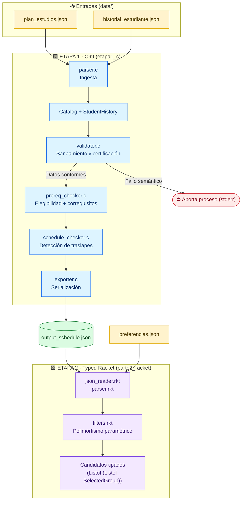

<h1 align="center">📅 CEmestre</h1>
<h3 align="center">Constructor Inteligente de Horarios</h3>

<p align="center">
  
  
</p>

<p align="center">
  
  
  
  
</p>

<p align="center">
  
  
  
  
  
</p>

---

## 📚 Tabla de Contenidos

| # | Sección | Contenido |
|:-:|---|---|
| 1 | [Visión General del Proyecto](#-1-visión-general-del-proyecto) | Objetivo y paradigmas |
| 2 | [Arquitectura y Flujo del Pipeline](#-2-arquitectura-y-flujo-del-pipeline) | Diagrama de punta a punta |
| 3 | [Estructura de Directorios](#-3-estructura-de-directorios) | Árbol del proyecto por zonas |
| 4 | [Constantes y Modelado de Datos en C](#-4-constantes-y-modelado-de-datos-en-c) | `config.h` y structs |
| 5 | [Descripción Modular de la Etapa 1](#-5-descripción-modular-de-la-etapa-1-etapa1_c) | Módulos en C |
| 6 | [Actualizaciones de Datos para la Etapa 2](#-6-actualizaciones-de-datos-para-la-etapa-2) | Plan a 6 semestres y preferencias |
| 7 | [Arquitectura Funcional en Racket](#-7-arquitectura-funcional-en-racket-parte2_racket) | Tipos, polimorfismo e ingesta |
| 8 | [Guía de Integración para Desarrolladores](#-8-guía-de-integración-para-desarrolladores-etapa-2) | Cómo consumir los módulos base |
| 9 | [Compilación y Ejecución](#-9-compilación-y-ejecución) | C y Racket |
| 10 | [Batería de Comandos de Inspección y Pruebas](#-10-batería-de-comandos-de-inspección-y-pruebas) | PowerShell y `jq` |
| 11 | [Manejo Defensivo y Casos Límite](#-11-manejo-defensivo-y-casos-límite) | Robustez del sistema |

---

## 🎯 1. Visión General del Proyecto

**CEmestre** es un sistema modular de planificación académica desarrollado para el **Instituto Tecnológico de Costa Rica (TEC)**. Su propósito es procesar la malla curricular de **Ingeniería en Computadores** e **Ingeniería en Biotecnología**, verificar el expediente del estudiante, determinar la elegibilidad de asignaturas mediante grafos de requisitos y correquisitos, identificar colisiones horarias y generar combinaciones válidas de matrícula libres de choques.

El sistema integra dos paradigmas de programación:

| | Etapa | Paradigma | Lenguaje | Responsabilidad |
|:-:|---|---|---|---|
| 🟦 | **Etapa 1** | Imperativo | **C99** | Ingesta, saneamiento, validación semántica, cálculo de elegibilidad académica y detección de traslapes en bloques de tiempo. |
| 🟪 | **Etapa 2** | Funcional | **Typed Racket** | Modelado inmutable con tipos estáticos explícitos, funciones de orden superior con polimorfismo paramétrico, evaluación perezosa mediante *streams* y generación combinatoria sin mutación de estado. |

---

## 🔄 2. Arquitectura y Flujo del Pipeline

El motor en C opera como una tubería de **extracción, transformación y validación (ETL)** que produce `data/output_schedule.json`. Este archivo es consumido, junto con `data/preferencias.json`, por los módulos funcionales en Racket.



<details>
<summary>📄 Ver versión en texto plano del pipeline</summary>

```text
[ data/plan_estudios.json ]        [ data/historial_estudiante.json ]
          │                                        │
          ▼                                        ▼
   [ parser.c ]                             [ parser.c ]
          │                                        │
          └───────────────────┬────────────────────┘
                              ▼
                 [ Catalog ] y [ StudentHistory ]
                              │
                              ▼
                       [ validator.c ] ──(Fallo semántico)──► Aborta proceso (stderr)
                              │
                      (Datos conformes)
                              ▼
                     [ prereq_checker.c ]
               (Elegibilidad + Correquisitos)
                              │
                              ▼
                    [ schedule_checker.c ]
                 (Detección de traslapes)
                              │
                              ▼
                       [ exporter.c ]
                              │
                              ▼
                 [ data/output_schedule.json ]
                              │
                              ▼  (Entrada Etapa 2)
                  [ json_reader.rkt / parser.rkt ] ◄── [ data/preferencias.json ]
                              │
                              ▼
              [ filters.rkt (Polimorfismo Paramétrico) ]
                              │
                              ▼
            [ Candidatos Tipados: (Listof (Listof SelectedGroup)) ]
```

</details>

### ⚙️ Fases de Ejecución de la Etapa 1

| Fase | Módulo | Descripción |
|:-:|---|---|
| **1** | `parser.c` | **Ingesta y deserialización.** Extrae datos jerárquicos desde los JSON de entrada y puebla las estructuras estáticas en memoria. |
| **2** | `validator.c` | **Saneamiento y certificación.** Normaliza cadenas, verifica integridad referencial, prohíbe cursos fantasma o auto-requisitos y asegura cronología horaria válida. |
| **3** | `prereq_checker.c` | **Resolución académica.** Calcula si una materia no aprobada cuenta con todos sus prerrequisitos y correquisitos viables. |
| **4** | `schedule_checker.c` | **Análisis temporal de colisiones.** Detecta traslapes horarios entre asignaturas elegibles de la misma carrera. |
| **5** | `exporter.c` | **Serialización estandarizada.** Emite el catálogo con los estados booleanos calculados: `is_approved`, `is_eligible`, `has_clash`, `has_any_schedule_clash`. |

---

## 🗂️ 3. Estructura de Directorios

```text
ProyectoCEmestre/
│
├── 📁 data/                              # ── Esquemas JSON (entradas y salida) ──
│   ├── historial_estudiante.json         # Materias aprobadas por el estudiante
│   ├── plan_estudios.json                # Catálogo oficial (Semestres 0 al 6)
│   ├── preferencias.json                 # Cursos de interés, grupos y rango de créditos
│   └── output_schedule.json              # Salida validada generada por C
│
├── 📁 etapa1_c/                          # ── 🟦 Motor imperativo en C99 ──
│   ├── Makefile                          # Script de compilación automatizada
│   │
│   ├── 📁 include/                       # Cabeceras y definiciones de estructuras
│   │   ├── config.h                      # Constantes de dimensionamiento
│   │   ├── exporter.h                    # Interfaz del serializador JSON
│   │   ├── parser.h                      # Interfaz del lector de entrada
│   │   ├── prereq_checker.h              # Interfaz del verificador de requisitos
│   │   ├── schedule_checker.h            # Interfaz del evaluador de horarios
│   │   ├── struct_definitions.h          # Modelado de structs en C
│   │   └── validator.h                   # Interfaz del validador de integridad
│   │
│   └── 📁 src/                           # Código fuente modular
│       ├── exporter.c                    # Escritor del JSON formateado
│       ├── main.c                        # Orquestador del flujo
│       ├── parser.c                      # Lector defensivo de cadenas JSON
│       ├── prereq_checker.c              # Prerrequisitos y correquisitos
│       ├── schedule_checker.c            # Detección de choques en bloques horarios
│       └── validator.c                   # Validador semántico y de formato
│
└── 📁 parte2_racket/                     # ── 🟪 Implementación funcional (Etapa 2) ──
    ├── types.rkt                         # Structs inmutables y LazyStream
    ├── filters.rkt                       # Funciones con polimorfismo paramétrico
    ├── json_reader.rkt                   # Puente de lectura JSON a tuplas nativas
    ├── parser.rkt                        # Conversión tipada y preparación de candidatos
    ├── generator.rkt                     # Motor combinatorio recursivo puro
    └── test.rkt                          # Suite de verificación de ingesta y tipos
```

### 🧭 Resumen por zona

| Zona | Carpeta | Rol | Archivos clave |
|:-:|---|---|---|
| 🟨 | `data/` | Contrato de datos entre etapas | `plan_estudios.json`, `historial_estudiante.json`, `preferencias.json`, `output_schedule.json` |
| 🟦 | `etapa1_c/include/` | Contratos de tipos e interfaces | `config.h`, `struct_definitions.h` |
| 🟦 | `etapa1_c/src/` | Lógica imperativa | `main.c`, `parser.c`, `validator.c`, `prereq_checker.c`, `schedule_checker.c`, `exporter.c` |
| 🟪 | `parte2_racket/` | Lógica funcional tipada | `types.rkt`, `filters.rkt`, `json_reader.rkt`, `parser.rkt`, `test.rkt` |

---

## 🧱 4. Constantes y Modelado de Datos en C

### 4.1 Constantes de dimensionamiento

Las dimensiones de memoria estática están centralizadas en `etapa1_c/include/config.h`:

<table>
  <thead>
    <tr>
      <th>Constante</th>
      <th align="center">Valor</th>
      <th>Finalidad técnica</th>
    </tr>
  </thead>
  <tbody>
    <tr><td><code>MAX_COURSES</code></td><td align="center"><code>200</code></td><td>Capacidad máxima de asignaturas simultáneas en el catálogo.</td></tr>
    <tr><td><code>MAX_GROUPS</code></td><td align="center"><code>10</code></td><td>Límite de grupos académicos ofertables por curso.</td></tr>
    <tr><td><code>MAX_SCHEDULES_PER_GROUP</code></td><td align="center"><code>5</code></td><td>Máximo de bloques horarios por grupo.</td></tr>
    <tr><td><code>MAX_PREREQUISITES</code></td><td align="center"><code>10</code></td><td>Límite superior de prerrequisitos por materia.</td></tr>
    <tr><td><code>MAX_COREQUISITES</code></td><td align="center"><code>5</code></td><td>Límite superior de correquisitos por materia.</td></tr>
    <tr><td><code>MAX_APPROVED_COURSES</code></td><td align="center"><code>100</code></td><td>Máximo de asignaturas acreditadas en el expediente.</td></tr>
    <tr><td><code>MAX_SEMESTER</code></td><td align="center"><code>6</code></td><td>Alcance curricular cubierto por el sistema.</td></tr>
    <tr><td><code>MAX_STRING_LEN</code></td><td align="center"><code>100</code></td><td>Tamaño de búfer para nombres y carreras.</td></tr>
    <tr><td><code>MAX_CODE_LEN</code></td><td align="center"><code>15</code></td><td>Tamaño de búfer para códigos alfanuméricos.</td></tr>
    <tr><td><code>DAY_MONDAY</code> – <code>DAY_SATURDAY</code></td><td align="center"><code>1</code> – <code>6</code></td><td>Representación numérica de los días lectivos.</td></tr>
  </tbody>
</table>

### 4.2 Estructuras centrales

Definidas en `etapa1_c/include/struct_definitions.h`:

| Estructura | Campos principales | Descripción |
|---|---|---|
| **`ScheduleBlock`** | `day`, `start_time`, `end_time` | Bloque horario en formato militar (ej. `730` a `1120`; `730` equivale a 07:30 y `1650` a 16:50). |
| **`Group`** | `group_number`, `schedules`, `schedule_count`, `has_clash` | Grupo académico con su arreglo de bloques y bandera individual de choque. |
| **`Course`** | `code`, `name`, `credits`, `semester`, `career`, prerrequisitos, correquisitos, `groups`, `is_approved`, `is_eligible`, `has_any_schedule_clash` | Asignatura completa con dependencias y banderas de decisión. |
| **`Catalog`** | arreglo de cursos, `course_count` | Contenedor global del catálogo. |
| **`StudentHistory`** | `approved_courses`, `approved_count` | Expediente del estudiante (códigos aprobados). |

---

## 🧩 5. Descripción Modular de la Etapa 1 (`etapa1_c`)

### 5.1 Verificador de Requisitos · `src/prereq_checker.c`

| Función | Qué hace |
|---|---|
| `is_course_approved` | Comprueba si un código consta en el historial del estudiante. |
| `can_take_course` | Certifica que la materia no haya sido aprobada previamente, que todos sus prerrequisitos estén cumplidos y que sus correquisitos sean simultáneamente matriculables (verificando, a su vez, los requisitos del correquisito). |

### 5.2 Validador Semántico · `src/validator.c`

| Función | Qué hace |
|---|---|
| `sanitize_code` | Limpia espacios residuales y uniforma códigos a mayúsculas. |
| `validate_catalog` | Normaliza códigos, impide cursos duplicados en la misma carrera, verifica que `career` no esté vacío, valida créditos (0 a 10) y semestres (0 a `MAX_SEMESTER`), y detecta requisitos fantasma, auto-dependencias y traslapes internos dentro de un mismo grupo. |
| `validate_student_history` | Asegura que las materias aprobadas existan en el catálogo y no estén duplicadas. |

### 5.3 Motor de Horarios · `src/schedule_checker.c`

| Función | Qué hace |
|---|---|
| `blocks_overlap` | Determina si dos bloques coinciden en día y se intersectan temporalmente. |
| `groups_overlap` | Compara exhaustivamente todos los bloques del Grupo A contra los del Grupo B. |
| `check_schedule_clashes` | Evalúa choques únicamente entre cursos elegibles (`is_eligible == true`) de la misma carrera. Marca `has_clash` por grupo y levanta `has_any_schedule_clash = true` en el curso si todos sus grupos colisionan sin alternativa. |

Regla de intersección horaria en el mismo día:

$$\text{start}_1 < \text{end}_2 \;\land\; \text{start}_2 < \text{end}_1$$

### 5.4 Deserializador y Serializador · `src/parser.c` y `src/exporter.c`

- **`parser.c`:** lectura binaria acotada en memoria (`read_file_to_string`), extracción delimitada de campos (`get_json_string_val`, `get_json_int_val`), captura de arreglos y parseo de llaves balanceadas (`parse_groups_and_schedules`), todo sin librerías externas y con candados de fin de cadena (`\0`) explícitos.
- **`exporter.c`:** escritura estandarizada hacia `data/output_schedule.json`, con control de comas terminales y booleanos nativos.

---

## 🔁 6. Actualizaciones de Datos para la Etapa 2

### 6.1 Ampliación curricular a 6 semestres · `data/plan_estudios.json`

Se extendió el catálogo con las guías oficiales de horarios hasta el sexto semestre para **Ingeniería en Computadores** e **Ingeniería en Biotecnología**, alcanzando un total de **91 asignaturas** con múltiples grupos y bloques horarios.

> [!NOTE]
> En `etapa1_c/include/config.h` se definió `MAX_SEMESTER 6` y `etapa1_c/src/validator.c` certifica la presencia del campo `career` y valida semestres en el intervalo $[0, 6]$.

### 6.2 Archivo de preferencias · `data/preferencias.json`

A diferencia de `historial_estudiante.json` (que refleja el pasado académico), este archivo modela la **intención de matrícula inmediata** y define los parámetros de entrada para la generación de horarios en Racket:

```json
{
  "min_credits": 8,
  "max_credits": 16,
  "interested_courses": [
    {
      "code": "CE1107",
      "career": "Ingeniería en Computadores",
      "groups": [1, 2]
    },
    {
      "code": "MA1102",
      "career": "Ingeniería en Computadores",
      "groups": [1]
    }
  ]
}
```

| Campo | Propósito |
|---|---|
| `min_credits` / `max_credits` | Rango de créditos deseados para el filtrado en Racket. |
| `career` (por curso) | Evita ambigüedades en materias compartidas entre carreras. |
| `groups` | Permite seleccionar múltiples grupos alternativos para un mismo curso de interés. |

---

## 🟪 7. Arquitectura Funcional en Racket (`parte2_racket`)

La base funcional está construida con **Typed Racket** (`#lang typed/racket`), lo que garantiza verificación estática de tipos, inmutabilidad por defecto y ausencia de efectos secundarios.

### 7.1 Modelado de tipos e inmutabilidad · `types.rkt`

Todas las estructuras del dominio son inmutables (`struct` sin `#:mutable`), y el módulo exporta constructores y selectores.

| Tipo | Campos | Descripción |
|---|---|---|
| **`LazyStream` / `StreamNode`** | `first`, promesa `(Promise (LazyStream A))` | Secuencias perezosas tipadas. Posterga la evaluación del resto del flujo con `delay` y la reclama bajo demanda con `force`. |
| **`ScheduleBlock`** | `[day : Integer]`, `[start-time : Integer]`, `[end-time : Integer]` | Bloque horario. |
| **`Group`** | `[group-number : Integer]`, `[has-clash : Boolean]`, `[schedules : (Listof ScheduleBlock)]` | Grupo con sus bloques. |
| **`Course`** | banderas `is-approved`, `is-eligible` y lista de grupos | Curso completo proveniente de C. |
| **`InterestedCourse`** y **`Preferences`** | `min-credits`, `max-credits`, `interested-courses` | Datos leídos desde `data/preferencias.json`. |
| **`SelectedGroup`** | `code`, `name`, `career`, `credits`, `group-number`, `has-clash`, `schedules` | **Estructura clave del generador.** Aplana una opción específica de matrícula uniendo los datos del curso con un grupo concreto. |
| **`ScheduleCombination`** | `[selections : (Listof SelectedGroup)]`, `[total-credits : Integer]` | Horario completo armado. |

### 7.2 Polimorfismo paramétrico · `filters.rkt`

Cumple el criterio de **Polimorfismo Paramétrico** mediante firmas genéricas `(All (A) ...)`, reutilizando la misma lógica sobre cualquier tipo (`Course`, `Group`, `SelectedGroup` o `ScheduleCombination`).

#### `filtrar-lista-polimorfico`

```racket
(: filtrar-lista-polimorfico (All (A) (-> (-> A Boolean) (Listof A) (Listof A))))
```

Recorre recursivamente una lista inmutable de elementos de tipo `A` y conserva únicamente los que satisfacen el predicado `(-> A Boolean)`, sin mutar variables.

#### `filtrar-stream-polimorfico`

```racket
(: filtrar-stream-polimorfico (All (A) (-> (-> A Boolean) (LazyStream A) (LazyStream A))))
```

Filtra un `LazyStream` de manera perezosa: evalúa el nodo actual (`StreamNode-first`) y envuelve la llamada recursiva del resto del flujo dentro de `(delay ...)`.

#### `stream->list-polimorfico`

```racket
(: stream->list-polimorfico (All (A) (-> (LazyStream A) (Listof A))))
```

Fuerza recursivamente las promesas de un `LazyStream` para convertirlo en una lista estándar cuando se requiera exportar el resultado final.

### 7.3 Ingesta segura y cruce de datos · `json_reader.rkt` y `parser.rkt`

> [!NOTE]
> Para evitar conflictos con el supertipo opaco `HashTableTop` de Racket 9.3 CS, la lectura se divide en dos capas.

| Capa | Lenguaje | Responsabilidad |
|---|---|---|
| **`json_reader.rkt`** | `#lang racket` | Lee `output_schedule.json` y `preferencias.json` con la librería nativa `json` y transforma los objetos en **tuplas inmutables**. |
| **`parser.rkt`** | `#lang typed/racket` | Importa las tuplas mediante `require/typed` con contratos de tipos estrictos y construye las estructuras tipadas con *pattern matching* (`match-define`). |

Funciones públicas de `parser.rkt`:

| Función | Entrada | Retorna |
|---|---|---|
| `load-catalog-from-json` | Ruta de `output_schedule.json` | `(Listof Course)` |
| `load-preferences-from-json` | Ruta de `preferencias.json` | `Preferences` |
| `prepare-candidate-courses` | Catálogo + preferencias | `(Listof (Listof SelectedGroup))` |

`prepare-candidate-courses` cruza el catálogo con las preferencias invocando **tres veces** a `filtrar-lista-polimorfico` (con tipos `Course`, `Group` y `(Listof SelectedGroup)`). Descarta cursos no elegibles (`is-eligible = #f`) y conserva únicamente los números de grupo deseados por el estudiante.

---

## 🤝 8. Guía de Integración para Desarrolladores (Etapa 2)

Esta sección detalla cómo los demás integrantes del equipo deben consumir los módulos base para implementar el **generador de combinaciones** (`generator.rkt`) y el **exportador de streams** (`exporter.rkt`).

### 8.1 Importación en nuevos archivos `.rkt`

Todo archivo nuevo en `parte2_racket/` debe iniciar con `#lang typed/racket` e importar los módulos base:

```racket
#lang typed/racket

(require "types.rkt"
         "filters.rkt"
         "parser.rkt")
```

### 8.2 Qué recibe el motor generador · `generator.rkt`

Al llamar a `(prepare-candidate-courses catalogo prefs)` se obtiene un valor de tipo:

```racket
(Listof (Listof SelectedGroup))
```

**Estructura de los datos:** cada sublista interna representa un curso válido que el estudiante quiere matricular, y dentro de ella vienen las opciones de grupos (`SelectedGroup`) solicitadas.

**Ejemplo práctico:** si el estudiante pidió `CE1107` (Grupos 1 y 2) y `MA1102` (Grupo 1), `prepare-candidate-courses` entrega:

```racket
(list
  (list (SelectedGroup "CE1107" ... 1 ...) (SelectedGroup "CE1107" ... 2 ...)) ; Opciones para CE1107
  (list (SelectedGroup "MA1102" ... 1 ...)))                                   ; Opciones para MA1102
```

#### Acceso a los campos de un `SelectedGroup`

| Selector | Retorna | Ejemplo |
|---|---|---|
| `(SelectedGroup-code sg)` | `String` | `"CE1107"` |
| `(SelectedGroup-group-number sg)` | `Integer` | `1` |
| `(SelectedGroup-credits sg)` | `Integer` | `4` |
| `(SelectedGroup-schedules sg)` | `(Listof ScheduleBlock)` | lista de bloques |

#### Acceso a cada bloque horario (`ScheduleBlock`) para verificar choques

| Selector | Retorna | Ejemplo |
|---|---|---|
| `(ScheduleBlock-day blk)` | `Integer` | `1` a `6` |
| `(ScheduleBlock-start-time blk)` | `Integer` | `730` |
| `(ScheduleBlock-end-time blk)` | `Integer` | `1120` |

### 8.3 Cómo construir y filtrar streams perezosos · `exporter.rkt`

**Crear un nodo en el stream perezoso:**

```racket
(StreamNode combinacion-actual
            (delay (generar-resto-de-combinaciones ...)))
```

**Filtrar el stream por rango de créditos** usando la función polimórfica:

```racket
(define horarios-en-rango
  (filtrar-stream-polimorfico
   (lambda ([comb : ScheduleCombination])
     (and (>= (ScheduleCombination-total-credits comb) (Preferences-min-credits prefs))
          (<= (ScheduleCombination-total-credits comb) (Preferences-max-credits prefs))))
   flujo-horarios-sin-choques))
```

---

## 🚀 9. Compilación y Ejecución

### 9.1 🟦 Etapa 1 · Lenguaje C

**Compilación con Makefile** desde el directorio `etapa1_c/`:

```bash
make
```

**Compilación manual alternativa con GCC:**

```bash
gcc -Wall -Wextra -std=c99 -Iinclude src/*.c -o cemestre_c
```

**Ejecución del binario.** Debe lanzarse desde dentro de `etapa1_c/` para resolver las rutas relativas `../data/`:

| Sistema | Comando |
|---|---|
| 🪟 Windows (PowerShell / CMD) | `.\cemestre_c.exe` |
| 🐧 Linux / 🍎 macOS | `./cemestre_c` |

**Salida esperada:**

```text
Proceso completado con éxito. Resultados guardados en ../data/output_schedule.json
```

> [!TIP]
> En entornos Windows sin `rm` nativo en el Path, para limpiar los archivos compilados se puede ejecutar en PowerShell:
>
> ```powershell
> Remove-Item -Force -ErrorAction SilentlyContinue cemestre_c.exe, *.o
> ```

### 9.2 🟪 Etapa 2 · Typed Racket

1. Abrir **DrRacket** y cargar el archivo `parte2_racket/test.rkt` (o `main.rkt` una vez integrado).
2. Presionar el botón **Run** (`Ctrl + R`).
3. El sistema leerá `../data/output_schedule.json` y `../data/preferencias.json`, ejecutará la validación de tipos y el filtrado polimórfico, y mostrará los cursos candidatos en consola.

---

## 🔍 10. Batería de Comandos de Inspección y Pruebas

Todos los comandos se ejecutan desde `etapa1_c/` y permiten auditar `data/output_schedule.json`.

### 🪟 Windows (PowerShell)

**1. Listar cursos de semestres 5 y 6:**

```powershell
(Get-Content -Raw -Path "..\data\output_schedule.json" | ConvertFrom-Json) | Where-Object { $_.semester -ge 5 } | Select-Object code, semester, career, is_eligible
```

**2. Verificar elegibilidad de una asignatura de semestre 5 (`CE1107`):**

```powershell
(Get-Content -Raw -Path "..\data\output_schedule.json" | ConvertFrom-Json) | Where-Object { $_.code -eq "CE1107" } | Select-Object code, name, semester, career, is_eligible, is_approved
```

**3. Auditar cantidad de cursos por semestre:**

```powershell
(Get-Content -Raw -Path "..\data\output_schedule.json" | ConvertFrom-Json) | Group-Object semester | Select-Object Name, Count | Sort-Object Name
```

**4. Contar el total de asignaturas exportadas:**

```powershell
(Get-Content -Raw -Path "..\data\output_schedule.json" | ConvertFrom-Json).Count
```

### 🐧 Linux / 🍎 macOS (Bash + `jq`)

**1. Listar cursos de semestres 5 y 6:**

```bash
jq '.[] | select(.semester >= 5) | {code, semester, career, is_eligible}' ../data/output_schedule.json
```

**2. Inspeccionar el estado detallado de `CE1107`:**

```bash
jq '.[] | select(.code == "CE1107") | {code, name, semester, is_eligible, is_approved}' ../data/output_schedule.json
```

**3. Conteo total de asignaturas registradas:**

```bash
jq 'length' ../data/output_schedule.json
```

---

## 🛡️ 11. Manejo Defensivo y Casos Límite

| 🔒 Caso | Cómo lo resuelve el sistema |
|---|---|
| **Desambiguación por carrera (`career`)** | Tanto en C (`validator.c` y `schedule_checker.c`) como en Racket (`prepare-candidate-courses`), los cursos se identifican por el par `(code, career)`. Esto resuelve el caso en que materias generales (ej. `MA0101`, `MA1102`, `CS1502`) comparten código en planes de estudio distintos. |
| **Aislamiento por carrera en choques** | Dos grupos con horarios idénticos no se marcan en colisión si pertenecen a carreras distintas, garantizando coherencia para estudiantes que cursan planes independientes. |
| **Independencia del nivel semestral en choques** | El motor evalúa colisiones entre cualesquiera dos cursos elegibles sin restringirlos al mismo semestre, soportando matrículas con cursos de rezago o adelanto. |
| **Prevención de ciclos de correquisitos** | La comprobación en `prereq_checker.c` valida la matriculabilidad de la materia par sin permitir recursión infinita. |
| **Tolerancia cero ante datos corruptos** | `validator.c` detiene la ejecución si detecta auto-dependencias, referencias a cursos inexistentes o intervalos de tiempo militar inconsistentes, evitando que datos corruptos lleguen a Racket. |
| **Frontera tipada contra datos dinámicos** | En `parte2_racket`, `require/typed` junto con desestructuración por patrones (`match-define`) garantiza que ningún dato malformado proveniente de un JSON externo viole las invariantes de tipos de Typed Racket. |

---

<p align="center">
  <sub>CEmestre · CE1106 Paradigmas de Programación · Instituto Tecnológico de Costa Rica</sub>
</p>
