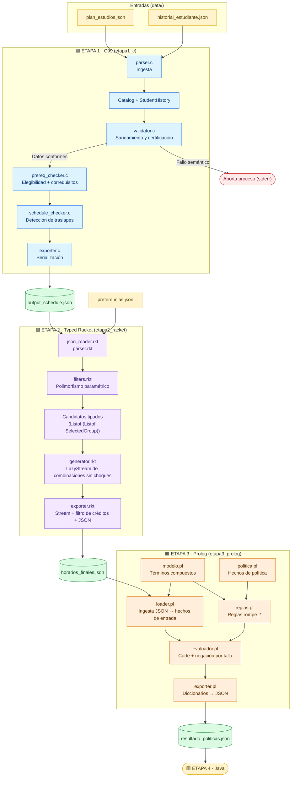
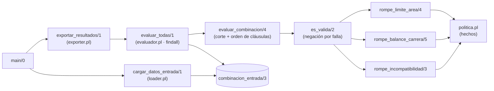

<h1 align="center">📅 CEmestre</h1>
<h3 align="center">Constructor Inteligente de Horarios</h3>

<p align="center">
  
  
</p>

<p align="center">
  
  
  
  
  
</p>

<p align="center">
  
  
  
  
  
  
</p>

---

## Tabla de Contenidos

| # | Sección | Contenido |
|:-:|---|---|
| 1 | [Visión General del Proyecto](#1-visión-general-del-proyecto) | Objetivo y paradigmas |
| 2 | [Arquitectura y Flujo del Pipeline](#2-arquitectura-y-flujo-del-pipeline) | Diagrama de punta a punta |
| 3 | [Estructura de Directorios](#3-estructura-de-directorios) | Árbol del proyecto por zonas |
| 4 | [Constantes y Modelado de Datos en C](#4-constantes-y-modelado-de-datos-en-c) | `config.h` y structs |
| 5 | [Descripción Modular de la Etapa 1](#5-descripción-modular-de-la-etapa-1-etapa1_c) | Módulos en C |
| 6 | [Actualizaciones de Datos para la Etapa 2](#6-actualizaciones-de-datos-para-la-etapa-2) | Plan a 8 semestres (111 asignaturas), preferencias y cambios de la Etapa 3 (área, créditos y archivos modificados) |
| 7 | [Arquitectura Funcional en Racket](#-7-arquitectura-funcional-en-racket-etapa2_racket) | Tipos, polimorfismo, ingesta, generación y exportación |
| 8 | [Guía de Integración para Desarrolladores](#8-guía-de-integración-para-desarrolladores-etapa-2) | Cómo consumir los módulos base |
| 9 | [Compilación y Ejecución](#9-compilación-y-ejecución) | C, Racket y Prolog, y flujo completo en Windows y Linux |
| 10 | [Batería de Comandos de Inspección y Pruebas](#10-batería-de-comandos-de-inspección-y-pruebas) | PowerShell y `jq` |
| 11 | [Manejo Defensivo y Casos Límite](#11-manejo-defensivo-y-casos-límite) | Robustez del sistema |
| 12 | [Decisiones de Diseño de la Etapa 2](#12-decisiones-de-diseño-de-la-etapa-2) | Justificaciones, caso límite real y formato de salida |
| 13 | [Estructuras de Datos Desarrolladas](#13-estructuras-de-datos-desarrolladas) | Tipos, tuplas intermedias y mapa de funciones |
| 14 | [Arquitectura Lógica en Prolog](#-14-arquitectura-lógica-en-prolog-etapa3_prolog) | Módulos, política, modelo, ingesta, reglas, evaluador, exportador y archivo de salida |
| 15 | [Decisiones de Diseño de la Etapa 3](#-15-decisiones-de-diseño-de-la-etapa-3) | Modelado, área, pares incompatibles, orden de reglas, corte y negación por falla, caso límite y formato de salida |
| 16 | [Predicados Principales y Modos de Consulta](#-16-predicados-principales-y-modos-de-consulta) | Mapa de predicados, ejemplos en más de un modo y cambios de política |

---

## 1. Visión General del Proyecto

**CEmestre** es un sistema modular de planificación académica desarrollado para el **Instituto Tecnológico de Costa Rica (TEC)**. Su propósito es procesar la malla curricular de **Ingeniería en Computadores** e **Ingeniería en Biotecnología**, verificar el expediente del estudiante, determinar la elegibilidad de asignaturas mediante grafos de requisitos y correquisitos, identificar colisiones horarias y generar combinaciones válidas de matrícula libres de choques. En la Etapa 3, cada combinación generada se evalúa además contra las reglas de política académica (balance entre carreras, límite por área e incompatibilidades), indicando si la cumple y, si no, cuál es la primera regla que viola.

El sistema integra tres paradigmas de programación:

| | Etapa | Paradigma | Lenguaje | Responsabilidad |
|:-:|---|---|---|---|
| 🟦 | **Etapa 1** | Imperativo | **C99** | Ingesta, saneamiento, validación semántica, cálculo de elegibilidad académica y detección de traslapes en bloques de tiempo. |
| 🟪 | **Etapa 2** | Funcional | **Typed Racket** | Modelado inmutable con tipos estáticos explícitos, funciones de orden superior con polimorfismo paramétrico, evaluación perezosa mediante *streams*, generación combinatoria sin mutación de estado, filtrado por rango de créditos y exportación de las combinaciones a `data/horarios_finales.json` para la Etapa 3 (Prolog). |
| 🟧 | **Etapa 3** | Lógico | **SWI-Prolog** | Carga de las combinaciones de Racket como hechos, evaluación contra tres reglas de política académica parametrizadas por hechos (balance entre carreras, límite por área e incompatibilidad simétrica de cursos), razón de rechazo (primera regla violada) mediante corte y negación por falla, y exportación del veredicto a `data/resultado_politicas.json` para la Etapa 4 (Java). |

---

## 2. Arquitectura y Flujo del Pipeline

El motor en C opera como una tubería de **extracción, transformación y validación (ETL)** que produce `data/output_schedule.json`. Este archivo es consumido, junto con `data/preferencias.json`, por los módulos funcionales en Racket, que generan las combinaciones sin choques, las filtran por rango de créditos y exportan `data/horarios_finales.json`, el contrato de entrada de la Etapa 3 (Prolog). Esta etapa carga esas combinaciones como hechos, las evalúa contra la política académica y exporta `data/resultado_politicas.json`, el contrato de entrada de la Etapa 4 (Java).



<details>
<summary>Ver versión en texto plano del pipeline</summary>

```text
[ data/plan_estudios.json ]        [ data/historial_estudiante.json ]
          │                                        │
          ▼                                        ▼
   [ parser.c ]                             [ parser.c ]
          │                                        │
          └───────────────────┬────────────────────┘
                              ▼
                 [ Catalog ] y [ StudentHistory ]
                              │
                              ▼
                       [ validator.c ] ──(Fallo semántico)──► Aborta proceso (stderr)
                              │
                      (Datos conformes)
                              ▼
                     [ prereq_checker.c ]
               (Elegibilidad + Correquisitos)
                              │
                              ▼
                    [ schedule_checker.c ]
                 (Detección de traslapes)
                              │
                              ▼
                       [ exporter.c ]
                              │
                              ▼
                 [ data/output_schedule.json ]
                              │
                              ▼  (Entrada Etapa 2)
                  [ json_reader.rkt / parser.rkt ] ◄── [ data/preferencias.json ]
                              │
                              ▼
              [ filters.rkt (Polimorfismo Paramétrico) ]
                              │
                              ▼
            [ Candidatos Tipados: (Listof (Listof SelectedGroup)) ]
                              │
                              ▼
                [ generator.rkt: generar-combinaciones ]
                              │   (LazyStream ScheduleCombination)
                              ▼
   [ exporter.rkt: filtrar-rango-creditos → exportar-combinaciones-json ]
                              │
                              ▼
                [ data/horarios_finales.json ]
                              │
                              ▼  (Entrada Etapa 3)
          [ loader.pl: cargar_datos_entrada ] ◄── [ politica.pl ] + [ modelo.pl ]
                              │   (hechos combinacion_entrada/3)
                              ▼
               [ evaluador.pl: evaluar_todas (findall) ]
                              │   evaluar_combinacion → es_valida (\+) → rompe_* (reglas.pl)
                              ▼
               [ exporter.pl: exportar_resultados → JSON ]
                              │
                              ▼
                [ data/resultado_politicas.json ]
                              │
                              ▼  (Entrada Etapa 4)
                           [ Java ]
```

</details>

### Fases de Ejecución de la Etapa 1

| Fase | Módulo | Descripción |
|:-:|---|---|
| **1** | `parser.c` | **Ingesta y deserialización.** Extrae datos jerárquicos desde los JSON de entrada y puebla las estructuras estáticas en memoria. |
| **2** | `validator.c` | **Saneamiento y certificación.** Normaliza cadenas, verifica integridad referencial, prohíbe cursos fantasma o auto-requisitos y asegura cronología horaria válida. Exige además que `career` y `area` estén presentes. |
| **3** | `prereq_checker.c` | **Resolución académica.** Calcula si una materia no aprobada cuenta con todos sus prerrequisitos y correquisitos viables. |
| **4** | `schedule_checker.c` | **Análisis temporal de colisiones.** Detecta traslapes horarios entre asignaturas elegibles de la misma carrera. |
| **5** | `exporter.c` | **Serialización estandarizada.** Emite el catálogo con los estados booleanos calculados: `is_approved`, `is_eligible`, `has_clash`, `has_any_schedule_clash`, junto con los campos del curso, incluida el `area`. |

### Fases de Ejecución de la Etapa 2

| Fase | Módulo | Descripción |
|:-:|---|---|
| **1** | `json_reader.rkt` / `parser.rkt` | **Ingesta tipada.** Lee `output_schedule.json` y `preferencias.json` y los convierte a structs inmutables (`Course`, `Preferences`). |
| **2** | `parser.rkt` (`prepare-candidate-courses`) | **Cruce catálogo–preferencias.** Descarta cursos no elegibles, conserva solo los grupos pedidos y entrega una sublista de `SelectedGroup` por curso. |
| **3** | `generator.rkt` | **Generación combinatoria perezosa.** Construye recursivamente, como `LazyStream`, las combinaciones con a lo sumo un grupo por curso (cada curso se incluye o se omite), descartando cualquier grupo que choque con los ya elegidos. |
| **4** | `exporter.rkt` (`filtrar-rango-creditos`) | **Filtrado.** Filtra el `LazyStream` por `[min_credits, max_credits]` con la función polimórfica, sin construir una lista intermedia. |
| **5** | `exporter.rkt` (`exportar-combinaciones-json`) | **Serialización.** Fuerza el stream nodo por nodo y escribe `data/horarios_finales.json`. |

### Fases de Ejecución de la Etapa 3

| Fase | Módulo | Descripción |
|:-:|---|---|
| **1** | `loader.pl` | **Ingesta y carga de hechos.** Lee `horarios_finales.json`, lo convierte en términos `curso/5` y `combinacion/3` y los registra como `combinacion_entrada/3`. |
| **2** | `politica.pl` / `modelo.pl` | **Parámetros y modelo.** Hechos de política (porcentaje máximo por carrera, máximo de cursos por área, pares incompatibles) y términos compuestos con sus selectores. |
| **3** | `reglas.pl` | **Reglas de política.** Tres predicados `rompe_*` (incompatibilidad, límite por área y balance entre carreras) parametrizados por los hechos de política. |
| **4** | `evaluador.pl` | **Decisión.** `es_valida/2` con negación por falla; `evaluar_combinacion/4` con corte y orden de cláusulas para reportar la primera regla violada; `evaluar_todas/1` recorre por *backtracking*. |
| **5** | `exporter.pl` | **Serialización.** Convierte cada resultado a un diccionario y escribe `data/resultado_politicas.json`. |
| **6** | `main.pl` | **Orquestación.** Carga los módulos en orden y ejecuta cargar, evaluar y exportar. |

---

## 3. Estructura de Directorios

```text
ProyectoCEmestre/
│
├── 📁 data/                              # ── Esquemas JSON (entradas y salida) ──
│   ├── historial_estudiante.json         # Materias aprobadas por el estudiante
│   ├── plan_estudios.json                # Catálogo oficial (Semestres 0 al 8, 111 asignaturas)
│   ├── preferencias.json                 # Cursos de interés, grupos y rango de créditos
│   ├── output_schedule.json              # Salida validada generada por C
│   ├── horarios_finales.json             # Salida de Racket: combinaciones sin choques (contrato con Prolog)
│   └── resultado_politicas.json          # Salida de Prolog: veredicto y razón por combinación (contrato con Java)
│
├── 📁 etapa1_c/                          # ── 🟦 Motor imperativo en C99 ──
│   ├── Makefile                          # Script de compilación automatizada
│   │
│   ├── 📁 include/                       # Cabeceras y definiciones de estructuras
│   │   ├── config.h                      # Constantes de dimensionamiento
│   │   ├── exporter.h                    # Interfaz del serializador JSON
│   │   ├── parser.h                      # Interfaz del lector de entrada
│   │   ├── prereq_checker.h              # Interfaz del verificador de requisitos
│   │   ├── schedule_checker.h            # Interfaz del evaluador de horarios
│   │   ├── struct_definitions.h          # Modelado de structs en C
│   │   └── validator.h                   # Interfaz del validador de integridad
│   │
│   └── 📁 src/                           # Código fuente modular
│       ├── exporter.c                    # Escritor del JSON formateado
│       ├── main.c                        # Orquestador del flujo
│       ├── parser.c                      # Lector defensivo de cadenas JSON
│       ├── prereq_checker.c              # Prerrequisitos y correquisitos
│       ├── schedule_checker.c            # Detección de choques en bloques horarios
│       └── validator.c                   # Validador semántico y de formato
│
├── 📁 etapa2_racket/                     # ── 🟪 Implementación funcional (Etapa 2) ──
│   ├── types.rkt                         # Structs inmutables y LazyStream
│   ├── filters.rkt                       # Funciones con polimorfismo paramétrico
│   ├── json_reader.rkt                   # Puente de lectura JSON a tuplas nativas
│   ├── parser.rkt                        # Conversión tipada y preparación de candidatos
│   ├── generator.rkt                     # Motor combinatorio recursivo puro (produce un LazyStream)
│   ├── exporter.rkt                      # Stream, filtro de créditos y exportación JSON
│   └── test.rkt                          # Prueba integral: ingesta, generación, filtrado y exportación
│
└── 📁 etapa3_prolog/                     # ── 🟧 Evaluador de políticas en Prolog (Etapa 3) ──
    ├── main.pl                           # Orquestador: carga módulos y ejecuta el flujo completo
    ├── politica.pl                       # Hechos de política (porcentajes, límite por área, incompatibles)
    ├── modelo.pl                         # Términos compuestos, constructores, selectores y auxiliares
    ├── loader.pl                         # Lectura del JSON de Racket y registro de hechos de entrada
    ├── reglas.pl                         # Las tres reglas de política (predicados rompe_*)
    ├── evaluador.pl                      # Motor de decisión: negación por falla, corte y backtracking
    └── exporter.pl                       # Serialización del veredicto a JSON
```

### Resumen por zona

| Zona | Carpeta | Rol | Archivos clave |
|:-:|---|---|---|
| 🟨 | `data/` | Contrato de datos entre etapas | `plan_estudios.json`, `historial_estudiante.json`, `preferencias.json`, `output_schedule.json`, `horarios_finales.json`, `resultado_politicas.json` |
| 🟦 | `etapa1_c/include/` | Contratos de tipos e interfaces | `config.h`, `struct_definitions.h` |
| 🟦 | `etapa1_c/src/` | Lógica imperativa | `main.c`, `parser.c`, `validator.c`, `prereq_checker.c`, `schedule_checker.c`, `exporter.c` |
| 🟪 | `etapa2_racket/` | Lógica funcional tipada | `types.rkt`, `filters.rkt`, `json_reader.rkt`, `parser.rkt`, `generator.rkt`, `exporter.rkt`, `test.rkt` |
| 🟧 | `etapa3_prolog/` | Lógica declarativa (hechos, reglas, corte y negación por falla) | `main.pl`, `politica.pl`, `modelo.pl`, `loader.pl`, `reglas.pl`, `evaluador.pl`, `exporter.pl` |

---

## 4. Constantes y Modelado de Datos en C

### 4.1 Constantes de dimensionamiento

Las dimensiones de memoria estática están centralizadas en `etapa1_c/include/config.h`:

<table>
  <thead>
    <tr>
      <th>Constante</th>
      <th align="center">Valor</th>
      <th>Finalidad técnica</th>
    </tr>
  </thead>
  <tbody>
    <tr><td><code>MAX_COURSES</code></td><td align="center"><code>200</code></td><td>Capacidad máxima de asignaturas simultáneas en el catálogo.</td></tr>
    <tr><td><code>MAX_GROUPS</code></td><td align="center"><code>10</code></td><td>Límite de grupos académicos ofertables por curso.</td></tr>
    <tr><td><code>MAX_SCHEDULES_PER_GROUP</code></td><td align="center"><code>5</code></td><td>Máximo de bloques horarios por grupo.</td></tr>
    <tr><td><code>MAX_PREREQUISITES</code></td><td align="center"><code>10</code></td><td>Límite superior de prerrequisitos por materia.</td></tr>
    <tr><td><code>MAX_COREQUISITES</code></td><td align="center"><code>5</code></td><td>Límite superior de correquisitos por materia.</td></tr>
    <tr><td><code>MAX_APPROVED_COURSES</code></td><td align="center"><code>100</code></td><td>Máximo de asignaturas acreditadas en el expediente.</td></tr>
    <tr><td><code>MAX_SEMESTER</code></td><td align="center"><code>8</code></td><td>Alcance curricular cubierto por el sistema (semestres 0 a 8; antes 6).</td></tr>
    <tr><td><code>MAX_STRING_LEN</code></td><td align="center"><code>100</code></td><td>Tamaño de búfer para nombres y carreras.</td></tr>
    <tr><td><code>MAX_CODE_LEN</code></td><td align="center"><code>15</code></td><td>Tamaño de búfer para códigos alfanuméricos.</td></tr>
    <tr><td><code>DAY_MONDAY</code> – <code>DAY_SATURDAY</code></td><td align="center"><code>1</code> – <code>6</code></td><td>Representación numérica de los días lectivos.</td></tr>
  </tbody>
</table>

> [!NOTE]
> **Holgura frente al catálogo real.** Con `data/plan_estudios.json` (111 asignaturas), el uso máximo observado es: 111 de `MAX_COURSES` (200) cursos; 6 de `MAX_GROUPS` (10) grupos en un mismo curso; 2 de `MAX_SCHEDULES_PER_GROUP` (5) bloques por grupo; 3 de `MAX_PREREQUISITES` (10) prerrequisitos y 2 de `MAX_COREQUISITES` (5) correquisitos. El nombre más largo mide 68 caracteres (límite `MAX_STRING_LEN` = 100) y el área más larga, 16. `MAX_APPROVED_COURSES` (100) cubre de sobra el historial de ejemplo (6 cursos aprobados).

### 4.2 Estructuras centrales

Definidas en `etapa1_c/include/struct_definitions.h`:

| Estructura | Campos principales | Descripción |
|---|---|---|
| **`ScheduleBlock`** | `day`, `start_time`, `end_time` | Bloque horario en formato militar (ej. `730` a `1120`; `730` equivale a 07:30 y `1650` a 16:50). |
| **`Group`** | `group_number`, `schedules`, `schedule_count`, `has_clash` | Grupo académico con su arreglo de bloques y bandera individual de choque. |
| **`Course`** | `code`, `name`, `credits`, `semester`, `career` y `area` (ambas `char[MAX_STRING_LEN]`), prerrequisitos, correquisitos, `groups`, `is_approved`, `is_eligible`, `has_any_schedule_clash` | Asignatura completa con dependencias y banderas de decisión. |
| **`Catalog`** | arreglo de cursos, `course_count` | Contenedor global del catálogo. |
| **`StudentHistory`** | `approved_courses`, `approved_count` | Expediente del estudiante (códigos aprobados). |

---

## 5. Descripción Modular de la Etapa 1 (`etapa1_c`)

### 5.1 Verificador de Requisitos · `src/prereq_checker.c`

| Función | Qué hace |
|---|---|
| `is_course_approved` | Comprueba si un código consta en el historial del estudiante. |
| `can_take_course` | Certifica que la materia no haya sido aprobada previamente, que todos sus prerrequisitos estén cumplidos y que sus correquisitos sean simultáneamente matriculables (verificando, a su vez, los requisitos del correquisito). |

### 5.2 Validador Semántico · `src/validator.c`

| Función | Qué hace |
|---|---|
| `sanitize_code` | Limpia espacios residuales y uniforma códigos a mayúsculas. |
| `validate_catalog` | Normaliza códigos, impide cursos duplicados en la misma carrera, verifica que `career` y `area` no estén vacíos (ambos son obligatorios), valida créditos (0 a 10) y semestres (0 a `MAX_SEMESTER`), y detecta requisitos fantasma, auto-dependencias y traslapes internos dentro de un mismo grupo. |
| `validate_student_history` | Asegura que las materias aprobadas existan en el catálogo y no estén duplicadas. |

### 5.3 Motor de Horarios · `src/schedule_checker.c`

| Función | Qué hace |
|---|---|
| `blocks_overlap` | Determina si dos bloques coinciden en día y se intersectan temporalmente. |
| `groups_overlap` | Compara exhaustivamente todos los bloques del Grupo A contra los del Grupo B. |
| `check_schedule_clashes` | Evalúa choques únicamente entre cursos elegibles (`is_eligible == true`) de la misma carrera. Marca `has_clash` por grupo y levanta `has_any_schedule_clash = true` en el curso si todos sus grupos colisionan sin alternativa. |

Regla de intersección horaria en el mismo día:

$$\text{start}_1 < \text{end}_2 \;\land\; \text{start}_2 < \text{end}_1$$

### 5.4 Deserializador y Serializador · `src/parser.c` y `src/exporter.c`

- **`parser.c`:** lectura binaria acotada en memoria (`read_file_to_string`), extracción delimitada de campos (`get_json_string_val`, `get_json_int_val`), captura de arreglos y parseo de llaves balanceadas (`parse_groups_and_schedules`), incluida la lectura del campo `area` de cada curso, todo sin librerías externas y con candados de fin de cadena (`\0`) explícitos.
- **`exporter.c`:** escritura estandarizada hacia `data/output_schedule.json`, con control de comas terminales y booleanos nativos. Cada curso incluye el campo `"area"`, entre `"career"` y `"credits"`.

---

## 6. Actualizaciones de Datos

### 6.1 Ampliación curricular a 8 semestres · `data/plan_estudios.json`

Se extendió el catálogo con las guías oficiales de horarios para **Ingeniería en Computadores** e **Ingeniería en Biotecnología**. La Etapa 2 llegaba hasta el sexto semestre (**91 asignaturas**); para la Etapa 3 el plan cubre los **semestres 0 al 8** y suma **111 asignaturas** con múltiples grupos y bloques horarios.

| Dato del catálogo | Valor |
|---|:-:|
| Asignaturas totales | **111** |
| Ingeniería en Computadores | 48 |
| Ingeniería en Biotecnología | 63 |
| Semestres cubiertos | 0 al 8 (ambas carreras) |
| Códigos presentes en las dos carreras | 10 (ver [15.2](#152-asignación-del-área)) |
| Áreas distintas | 14 (ver [15.2](#152-asignación-del-área)) |
| Cursos elegibles con `historial_estudiante.json` | 28 (el historial de ejemplo tiene 6 códigos aprobados, que marcan 7 entradas del catálogo porque `MA0101` está en las dos carreras) |

> [!NOTE]
> En `etapa1_c/include/config.h` se definió `MAX_SEMESTER 8` (antes `6`) y `etapa1_c/src/validator.c` certifica la presencia de los campos `career` y `area` y valida semestres en el intervalo $[0, 8]$. `MAX_COURSES` (200) sigue sobrando para las 111 asignaturas.

### 6.2 Archivo de preferencias · `data/preferencias.json`

A diferencia de `historial_estudiante.json` (que refleja el pasado académico), este archivo modela la **intención de matrícula inmediata** y define los parámetros de entrada para la generación de horarios en Racket:

```json
{
  "min_credits": 8,
  "max_credits": 16,
  "interested_courses": [
    {
      "code": "CE1107",
      "career": "Ingeniería en Computadores",
      "groups": [1, 2]
    },
    {
      "code": "MA1102",
      "career": "Ingeniería en Computadores",
      "groups": [1]
    },
    {
      "code": "MA1403",
      "career": "Ingeniería en Computadores",
      "groups": [1]
    },
    {
      "code": "CE1105",
      "career": "Ingeniería en Computadores",
      "groups": [1]
    },
    {
      "code": "CS1502",
      "career": "Ingeniería en Computadores",
      "groups": [1]
    }
  ]
}
```

| Campo | Propósito |
|---|---|
| `min_credits` / `max_credits` | Rango de créditos deseados para el filtrado en Racket. Ambos extremos son **inclusivos** y los aplica `filtrar-rango-creditos` (`exporter.rkt`). |
| `career` (por curso) | Evita ambigüedades en materias compartidas entre carreras. Si se deja vacío (`""`), `prepare-candidate-courses` acepta el primer curso elegible con ese código. |
| `groups` | Permite seleccionar múltiples grupos alternativos para un mismo curso de interés. |

**Qué produce este archivo con los datos del repositorio.** Se piden 5 cursos (`CE1107` con dos grupos y los demás con uno), así que hay 6 grupos candidatos. Como el generador también considera las combinaciones que omiten cursos (sección [7.4](#74-generador-de-combinaciones--generatorrkt)), `generar-combinaciones` produce **32** combinaciones sin choques (incluida la vacía); `filtrar-rango-creditos` deja las **17** cuyo total está entre 8 y 16 créditos y esas son las que llegan a `horarios_finales.json` y a Prolog. El desarrollo completo está en la sección [15.11](#1511-ejemplo-de-extremo-a-extremo-con-los-archivos-reales).

### 6.3 Extensión del proyecto para la Etapa 3

El enunciado de la Etapa 3 pide ajustar las etapas anteriores **sin modificar la lógica ya construida**: un campo `area` obligatorio por curso (se agrega en C y se propaga por Racket), toda información adicional que Prolog necesite (aquí, los créditos por curso) y la extensión del plan a 8 semestres por carrera. Esta sección registra qué se cambió y dónde.

| Requisito del enunciado | Qué se hizo | Estado |
|---|---|---|
| **Campo `area` obligatorio por curso** (se agrega en C y se propaga por Racket). | Se lee y se exige en C, se exporta en `output_schedule.json`, se propaga por Racket hasta `horarios_finales.json` y lo consume Prolog (tabla 6.3.1). | Implementado |
| **Créditos por curso** en la exportación de Racket, justificados. | `formato-grupo-json` escribe `credits` por selección (sección [7.6.1](#761-ampliación-del-contrato-para-la-etapa-3)). | Implementado |
| **Plan de estudios ampliado a 8 semestres** por carrera (antes 6), reutilizando el módulo de C con más datos. | Más cursos en `plan_estudios.json` y `MAX_SEMESTER` pasa de 6 a 8 en `config.h`; no cambia la lógica de las etapas anteriores. | Implementado: semestres 0 al 8, 111 asignaturas y `MAX_SEMESTER 8` (sección 6.1) |

#### 6.3.1 Propagación del campo `area` (de C a Prolog)

| Paso | Archivo | Qué hace con `area` |
|:-:|---|---|
| 1 | `data/plan_estudios.json` | Cada curso declara su `area`. Es la fuente del dato (ver la asignación en la [sección 15.2](#152-asignación-del-área)). |
| 2 | `etapa1_c/src/parser.c` | `load_catalog` lo lee con `get_json_string_val(brace_start, "area", c->area, sizeof(c->area))`. |
| 3 | `etapa1_c/src/validator.c` | `validate_catalog` lo exige: un curso con `area` vacía produce el error `El curso no tiene un área asignada.` y `main.c` aborta antes de exportar. |
| 4 | `etapa1_c/src/exporter.c` | Escribe `"area"` (entre `career` y `credits`) en cada curso de `data/output_schedule.json`. |
| 5 | `etapa2_racket/json_reader.rkt` | `read-catalog-raw` lo extrae con `(hash-ref c 'area "")` como cuarto elemento de la tupla del curso. |
| 6 | `etapa2_racket/types.rkt` y `parser.rkt` | `Course-area` se carga en el struct `Course`; `prepare-candidate-courses` lo copia a `SelectedGroup-area`. |
| 7 | `etapa2_racket/exporter.rkt` | `formato-grupo-json` lo escribe en cada selección de `data/horarios_finales.json`. |
| 8 | `etapa3_prolog/loader.pl` | Lo lee de `selections[].area` y lo guarda en el término `curso/5` (sección [14.4](#144-ingesta--loaderpl)). |

#### 6.3.2 Archivos modificados para la Etapa 3

| Etapa | Archivo | Cambio |
|:-:|---|---|
| 🟦 C | `include/config.h` | `MAX_SEMESTER` pasa de `6` a `8` para admitir el plan de 8 semestres. |
| 🟦 C | `include/struct_definitions.h` | El struct `Course` incluye el campo `area` (`char area[MAX_STRING_LEN]`, justo después de `career`), usado por `parser.c`, `validator.c` y `exporter.c`. |
| 🟨 Datos | `data/plan_estudios.json` | Semestres 0 al 8 (111 asignaturas) y el campo `area` en cada curso. |
| 🟨 Datos | `data/preferencias.json` | Cinco cursos de interés (`CE1107`, `MA1102`, `MA1403`, `CE1105`, `CS1502`) y rango de 8 a 16 créditos (sección 6.2). |
| 🟦 C | `src/parser.c` | Lee `"area"` de cada curso del plan. |
| 🟦 C | `src/validator.c` | `area` pasa a ser un campo obligatorio (igual que `career`). |
| 🟦 C | `src/exporter.c` | Exporta `"area"` en `output_schedule.json`. |
| 🟪 Racket | `types.rkt` | `Course` y `SelectedGroup` reciben el campo `area : String` (justo después de `career`). |
| 🟪 Racket | `json_reader.rkt` | La tupla del curso lleva `area` en la cuarta posición (sección [13.3](#133-tuplas-intermedias-de-json_readerrkt)). |
| 🟪 Racket | `parser.rkt` | La declaración `require/typed` y `raw->course` incluyen `area`; `prepare-candidate-courses` lo copia al `SelectedGroup`. |
| 🟪 Racket | `generator.rkt` | `generar-combinaciones` produce directamente un `LazyStream` (sección [7.4](#74-generador-de-combinaciones--generatorrkt)). |
| 🟪 Racket | `exporter.rkt` | `formato-grupo-json` escribe `area` y `credits`; `list->lazy-stream` ya no existe (sección [7.5](#75-exportador--exporterrkt)). |
| 🟪 Racket | `test.rkt` | Consume el stream del generador directamente, sin conversión intermedia (sección [9.2](#92--etapa-2--typed-racket)). |
| 🟧 Prolog | `etapa3_prolog/` | Módulo nuevo (secciones [14](#-14-arquitectura-lógica-en-prolog-etapa3_prolog), [15](#-15-decisiones-de-diseño-de-la-etapa-3) y [16](#-16-predicados-principales-y-modos-de-consulta)). |

#### 6.3.3 Compatibilidad con las etapas previas

- **El formato de los archivos solo creció.** `output_schedule.json` ganó la llave `area` y `horarios_finales.json` ganó `area` y `credits` por selección; no se quitó ni se renombró ninguna llave existente.
- **Los lectores toleran llaves nuevas.** `parser.c` busca cada campo por nombre dentro del objeto del curso y `json_reader.rkt` usa `hash-ref` con valor por defecto, así que ninguno depende de las llaves que no usa.
- **La lógica de choques y de créditos no cambió:** la regla de intersección horaria de `schedule_checker.c` (sección 5.3) es la misma que usa `bloques-chocan?` en Racket, y el filtro de créditos sigue siendo inclusivo en ambos extremos.
- **El generador sí cambió de forma de entrega y de alcance:** ahora devuelve un `LazyStream` y su resultado incluye combinaciones que omiten cursos de interés (secciones [7.4](#74-generador-de-combinaciones--generatorrkt) y [12.1](#121-justificación-de-decisiones-propias), decisiones 6 y 12).

> [!NOTE]
> **Valores finales del catálogo.** `MAX_SEMESTER` es `8`, el catálogo tiene 111 asignaturas (48 de Computadores y 63 de Biotecnología) y el criterio de asignación del área está documentado, con ejemplos de ambos planes, en la sección [15.2](#152-asignación-del-área). `validator.c` valida el semestre contra `MAX_SEMESTER`, definido en `config.h`.

---

## 🟪 7. Arquitectura Funcional en Racket (`etapa2_racket`)

La base funcional está construida con **Typed Racket** (`#lang typed/racket`), lo que garantiza verificación estática de tipos, inmutabilidad por defecto y ausencia de efectos secundarios.

### 7.1 Modelado de tipos e inmutabilidad · `types.rkt`

Todas las estructuras del dominio son inmutables (`struct` sin `#:mutable`), y el módulo exporta constructores y selectores.

| Tipo | Campos | Descripción |
|---|---|---|
| **`LazyStream` / `StreamNode`** | `first`, promesa `(Promise (LazyStream A))` | Secuencias perezosas tipadas. Posterga la evaluación del resto del flujo con `delay` y la reclama bajo demanda con `force`. |
| **`ScheduleBlock`** | `[day : Integer]`, `[start-time : Integer]`, `[end-time : Integer]` | Bloque horario. |
| **`Group`** | `[group-number : Integer]`, `[has-clash : Boolean]`, `[schedules : (Listof ScheduleBlock)]` | Grupo con sus bloques. |
| **`Course`** | `area` (campo nuevo de la Etapa 3), banderas `is-approved`, `is-eligible` y lista de grupos | Curso completo proveniente de C. |
| **`InterestedCourse`** y **`Preferences`** | `min-credits`, `max-credits`, `interested-courses` | Datos leídos desde `data/preferencias.json`. |
| **`SelectedGroup`** | `code`, `name`, `career`, `area`, `credits`, `group-number`, `has-clash`, `schedules` | **Estructura clave del generador.** Aplana una opción específica de matrícula uniendo los datos del curso con un grupo concreto. |
| **`ScheduleCombination`** | `[selections : (Listof SelectedGroup)]`, `[total-credits : Integer]` | Horario completo armado. |

### 7.2 Polimorfismo paramétrico · `filters.rkt`

Cumple el criterio de **Polimorfismo Paramétrico** mediante firmas genéricas `(All (A) ...)`, reutilizando la misma lógica sobre cualquier tipo (`Course`, `Group`, `SelectedGroup` o `ScheduleCombination`).

#### `filtrar-lista-polimorfico`

```racket
(: filtrar-lista-polimorfico (All (A) (-> (-> A Boolean) (Listof A) (Listof A))))
```

Recorre recursivamente una lista inmutable de elementos de tipo `A` y conserva únicamente los que satisfacen el predicado `(-> A Boolean)`, sin mutar variables.

#### `filtrar-stream-polimorfico`

```racket
(: filtrar-stream-polimorfico (All (A) (-> (-> A Boolean) (LazyStream A) (LazyStream A))))
```

Filtra un `LazyStream` de manera perezosa: evalúa el nodo actual (`StreamNode-first`) y envuelve la llamada recursiva del resto del flujo dentro de `(delay ...)`.

#### `stream->list-polimorfico`

```racket
(: stream->list-polimorfico (All (A) (-> (LazyStream A) (Listof A))))
```

Fuerza recursivamente las promesas de un `LazyStream` para convertirlo en una lista estándar cuando se requiera exportar el resultado final.

### 7.3 Ingesta segura y cruce de datos · `json_reader.rkt` y `parser.rkt`

> [!NOTE]
> Para evitar conflictos con el supertipo opaco `HashTableTop` de Racket 9.3 CS, la lectura se divide en dos capas.

| Capa | Lenguaje | Responsabilidad |
|---|---|---|
| **`json_reader.rkt`** | `#lang racket` | Lee `output_schedule.json` y `preferencias.json` con la librería nativa `json` y transforma los objetos en **tuplas inmutables**. |
| **`parser.rkt`** | `#lang typed/racket` | Importa las tuplas mediante `require/typed` con contratos de tipos estrictos y construye las estructuras tipadas con *pattern matching* (`match-define`). |

Funciones públicas de `parser.rkt`:

| Función | Entrada | Retorna |
|---|---|---|
| `load-catalog-from-json` | Ruta de `output_schedule.json` | `(Listof Course)` |
| `load-preferences-from-json` | Ruta de `preferencias.json` | `Preferences` |
| `prepare-candidate-courses` | Catálogo + preferencias | `(Listof (Listof SelectedGroup))` |

`prepare-candidate-courses` cruza el catálogo con las preferencias invocando **tres veces** a `filtrar-lista-polimorfico` (con tipos `Course`, `Group` y `(Listof SelectedGroup)`). Descarta cursos no elegibles (`is-eligible = #f`) y conserva únicamente los números de grupo deseados por el estudiante. El `area` de cada curso se copia de `Course-area` al `SelectedGroup` (campo nuevo de la Etapa 3, sección [6.3.1](#631-propagación-del-campo-area-de-c-a-prolog)).

### 7.4 Generador de combinaciones · `generator.rkt`

Recibe la salida de `prepare-candidate-courses` y produce, como un **`LazyStream`**, todas las combinaciones válidas: **a lo sumo un grupo por curso de interés y sin traslapes entre los grupos elegidos**. Cada curso se incluye con uno de sus grupos o se omite, así que el stream contiene también las combinaciones parciales y la combinación vacía. Solo exporta `generar-combinaciones` (el módulo requiere únicamente `types.rkt`); el resto son auxiliares privadas.

| Función | Firma | Qué hace |
|---|---|---|
| `bloques-chocan?` | `(-> ScheduleBlock ScheduleBlock Boolean)` | Dos bloques chocan si son del mismo día y se intersectan. Es la misma regla de `schedule_checker.c`, por lo que dos bloques contiguos (el fin de uno igual al inicio del otro) **no** chocan. |
| `choca-con-lista?` | `(-> ScheduleBlock (Listof ScheduleBlock) Boolean)` | Recorre recursivamente una lista de bloques y se detiene en el primer choque. |
| `horarios-grupo-chocan?` | `(-> (Listof ScheduleBlock) (Listof ScheduleBlock) Boolean)` | Recorre los bloques del grupo nuevo y se detiene en el primero que choca con alguno de los bloques ya elegidos. |
| `extraer-horarios` | `(-> (Listof SelectedGroup) (Listof ScheduleBlock))` | Aplana recursivamente (con `append`) los bloques de los grupos ya elegidos. |
| `grupo-valido-en-combinacion?` | `(-> SelectedGroup (Listof SelectedGroup) Boolean)` | Es verdadero si ningún bloque del grupo nuevo choca con los bloques de los grupos ya elegidos. |
| `concatenar-streams` | `(All (A) (-> (LazyStream A) (Promise (LazyStream A)) (LazyStream A)))` | **Función polimórfica.** Concatena dos streams de forma perezosa: el segundo llega como promesa y solo se fuerza cuando se agota el primero. |
| `insertar-grupo-en-stream` | `(-> SelectedGroup (LazyStream ScheduleCombination) (LazyStream ScheduleCombination))` | Para cada combinación del stream, si el grupo no choca con sus selecciones produce una nueva combinación con el grupo al frente (`cons`) y los créditos sumados; si choca, esa combinación se omite. Cada nodo guarda su resto bajo `(delay ...)`. |
| `expandir-grupos-stream` | `(-> (Listof SelectedGroup) (LazyStream ScheduleCombination) (LazyStream ScheduleCombination))` | Aplica `insertar-grupo-en-stream` a cada grupo alternativo del curso actual y concatena los resultados con `concatenar-streams`. |
| `generar-combinaciones` | `(-> (Listof (Listof SelectedGroup)) (LazyStream ScheduleCombination))` | Función principal. Recursión estructural sobre la lista de cursos. |

**Algoritmo de `generar-combinaciones`:**

1. **Caso base.** Con `'()` devuelve un stream de un único nodo, `(StreamNode (ScheduleCombination '() 0) (delay '()))`: la combinación vacía con 0 créditos, que actúa como elemento neutro.
2. **Paso recursivo.** Obtiene `flujo-resto` llamándose con `(cdr lista)`. Luego calcula `flujo-con-curso` con `expandir-grupos-stream` (los grupos del curso actual aplicados a `flujo-resto`) y devuelve `(concatenar-streams flujo-con-curso (delay flujo-resto))`, es decir:
   - primero las combinaciones que **incluyen** el curso actual, una por cada grupo del curso que no choque con las selecciones de cada combinación del resto;
   - después, las combinaciones que **omiten** el curso actual (`flujo-resto` tal cual).
3. **Poda.** Si el grupo nuevo choca con las selecciones de una combinación, `insertar-grupo-en-stream` no produce esa combinación, así que **se descarta en ese punto y nunca se extiende**.

Los créditos se acumulan incrementalmente al construir cada combinación, sin recorrer la lista al final. Las selecciones de cada combinación quedan en el mismo orden en que los cursos aparecen en `preferencias.json`. En el stream aparecen primero las combinaciones que incluyen el primer curso (ordenadas por su grupo) y después las que lo omiten; la combinación vacía es siempre el último elemento.

**Ejemplo:** con `CE1107` (grupos 1 y 2, 4 créditos cada uno) y `MA1102` (grupo 1, 4 créditos), si el grupo 2 de `CE1107` choca con `MA1102-G1`, `generar-combinaciones` produce, en este orden:

| # | Selecciones | Créditos |
|:-:|---|:-:|
| 1 | `CE1107-G1`, `MA1102-G1` | 8 |
| 2 | `CE1107-G1` | 4 |
| 3 | `CE1107-G2` | 4 |
| 4 | `MA1102-G1` | 4 |
| 5 | *(vacía)* | 0 |

La combinación `CE1107-G2` + `MA1102-G1` no aparece porque choca. Con el rango de la sección [6.2](#62-archivo-de-preferencias--datapreferenciasjson) (8 a 16 créditos), `filtrar-rango-creditos` deja únicamente la primera: `[CE1107-G1, MA1102-G1]`.

> [!NOTE]
> El ejemplo anterior es ilustrativo (supone un choque inventado). Con los datos reales de `preferencias.json` los choques son otros: `CE1107-G1` (martes y jueves 13:00–14:50) choca con `MA1403-G1` (martes 13:00–16:50) y `CE1107-G2` (martes y jueves 09:30–11:20) choca con `CE1105-G1` (martes 07:30–11:20). El resultado completo, con sus 32 combinaciones, está en la sección [15.11](#1511-ejemplo-de-extremo-a-extremo-con-los-archivos-reales).

> [!NOTE]
> **Intención del diseño.** Antes, un choque en cualquier curso hacía que el generador descartara la combinación completa. Ahora, cuando un grupo choca, el generador sigue construyendo la combinación con los demás cursos, de modo que los horarios generados **no necesariamente contienen todas las preferencias**. Esto es deliberado: `preferencias.json` ofrece pocos grupos por curso y cada grupo tiene pocos bloques horarios, por lo que rara vez todos los cursos de interés caben juntos.
>
> **Alcance de la omisión.** El generador no limita la omisión a los cursos que chocan: genera **todos los subconjuntos** de cursos sin traslapes, incluidos los que omiten un curso aunque este cabría (por ejemplo, la combinación n.° 4 de la sección [15.11](#1511-ejemplo-de-extremo-a-extremo-con-los-archivos-reales), `CE1107-G1` + `MA1102-G1`, no incluye `CS1502-G1` a pesar de que no choca con ninguno). El rango de créditos reduce ese conjunto, pero no lo limita a combinaciones maximales.

> [!NOTE]
> En el peor caso el número de combinaciones es el producto, sobre todos los cursos, de (cantidad de grupos solicitados + 1); el `+ 1` es la opción de omitir el curso. El generador no construye esa lista completa: cada nodo se calcula cuando el consumidor (el filtro o la escritura) fuerza `StreamNode-rest`, y las promesas memorizan su resultado, de modo que recorrer el mismo stream una segunda vez no repite el cálculo. Ver las decisiones 6 y 12 en la [sección 12.1](#121-justificación-de-decisiones-propias).

### 7.5 Exportador · `exporter.rkt`

Filtra por créditos el stream de combinaciones que entrega el generador y lo escribe a disco. Requiere `types.rkt` y `filters.rkt`, y exporta dos funciones públicas.

| Función | Firma | Qué hace |
|---|---|---|
| `filtrar-rango-creditos` | `(-> Integer Integer (LazyStream ScheduleCombination) (LazyStream ScheduleCombination))` | Filtra el stream conservando las combinaciones con `min <= total-credits <= max` (extremos inclusivos). |
| `exportar-combinaciones-json` | `(-> String (LazyStream ScheduleCombination) Void)` | Escribe el stream en la ruta indicada como un arreglo JSON. Sobrescribe el archivo si existe (`#:exists 'replace`). |

> [!NOTE]
> `exporter.rkt` ya no define `list->lazy-stream`: la conversión de lista a stream dejó de ser necesaria porque `generar-combinaciones` entrega el `LazyStream` directamente (sección [7.4](#74-generador-de-combinaciones--generatorrkt)).

**`filtrar-rango-creditos` no define recursión propia.** Es la instancia de `filtrar-stream-polimorfico` con `A = ScheduleCombination` y un predicado de rango. Es la misma función genérica que `parser.rkt` usa sobre listas de `Course`, `Group` y `(Listof SelectedGroup)`.

**Funciones privadas de formato** (construyen el texto JSON sin librerías externas):

| Función | Firma | Qué hace |
|---|---|---|
| `formato-grupo-json` | `(-> SelectedGroup String)` | Serializa un objeto `{course_code, group_number, career, area, credits}`, en ese orden. |
| `grupos->json` | `(-> (Listof SelectedGroup) String)` | Une los objetos con `",\n"` por recursión. Evita coma final con tres casos: lista vacía, último elemento y resto. |
| `formato-combinacion-json` | `(-> ScheduleCombination String)` | Serializa `{total_credits, selections: [...]}`. |
| `escribir-stream-json` | `(-> Output-Port (LazyStream ScheduleCombination) Boolean Void)` | Recorre el stream forzando **un nodo a la vez** y escribe cada combinación apenas se obtiene. |

**Manejo de las comas sin mutación.** `escribir-stream-json` recibe un parámetro `es-primero?`: la coma separadora se escribe solo cuando es `#false`, y la llamada recursiva (en posición de cola) pasa `#false`. El estado se lleva en el argumento de la recursión, sin contadores ni variables reasignadas.

**Uso desde `test.rkt`:**

```racket
(define flujo-combinaciones (generar-combinaciones candidatos))
(define flujo-filtrado (filtrar-rango-creditos
                        (Preferences-min-credits prefs)
                        (Preferences-max-credits prefs)
                        flujo-combinaciones))
(exportar-combinaciones-json "../data/horarios_finales.json" flujo-filtrado)
```

`test.rkt` recorre `flujo-filtrado` dos veces: la primera para imprimir cada combinación y contarlas (sección 4 de la prueba) y la segunda para exportarlas (sección 5). Como las promesas de `StreamNode-rest` memorizan su valor, el segundo recorrido reutiliza los nodos ya calculados.

### 7.6 Archivo de salida · `data/horarios_finales.json`

Es el **contrato de la Etapa 3 (Prolog)**. Contiene un arreglo JSON en el nivel superior, con un objeto por combinación válida (sin choques y dentro del rango de créditos). Pueden aparecer combinaciones parciales, que omiten algún curso de interés, siempre que sus créditos estén dentro del rango (sección [7.4](#74-generador-de-combinaciones--generatorrkt)).

```json
[
  {
    "total_credits": 8,
    "selections": [
        {
          "course_code": "CE1107",
          "group_number": 1,
          "career": "Ingeniería en Computadores",
          "area": "Computadores",
          "credits": 4
        },
        {
          "course_code": "MA1102",
          "group_number": 1,
          "career": "Ingeniería en Computadores",
          "area": "Matemáticas",
          "credits": 4
        }
    ]
  }
]
```

> [!NOTE]
> Los valores de `area` del ejemplo son ilustrativos: dependen de lo que declare `plan_estudios.json` (sección [6.3.1](#631-propagación-del-campo-area-de-c-a-prolog)).

| Campo | Tipo | Origen | Requisito de la etapa que cubre |
|---|---|---|---|
| `total_credits` | entero | `ScheduleCombination-total-credits` | Créditos totales |
| `selections` | arreglo de objetos | `ScheduleCombination-selections` | Lista de pares curso-grupo |
| `selections[].course_code` | cadena | `SelectedGroup-code` | Curso del par curso-grupo |
| `selections[].group_number` | entero | `SelectedGroup-group-number` | Grupo del par curso-grupo |
| `selections[].career` | cadena | `SelectedGroup-career` | Carrera de origen de cada curso |
| `selections[].area` | cadena | `SelectedGroup-area` | Campo nuevo obligatorio de la Etapa 3 (regla de límite por área) |
| `selections[].credits` | entero | `SelectedGroup-credits` | Información adicional justificada (regla de balance entre carreras) |

**Garantías del archivo:**

- Ninguna combinación tiene dos grupos con bloques traslapados.
- Todo `total_credits` cumple `min_credits <= total_credits <= max_credits` (inclusivo).
- Cada combinación tiene como máximo un grupo por curso, y solo de los cursos de interés que están habilitados (`is_eligible`).
- Una combinación puede no incluir todos los cursos de interés; lo que se exige es el rango de créditos.
- Las `selections` conservan el orden de `preferencias.json`.
- El archivo siempre es JSON válido, también cuando ninguna combinación cumple el rango (en ese caso queda `[` + línea vacía + `]`).
- En la Etapa 2 el contrato solo tenía `course_code`, `group_number` y `career` por selección; para la Etapa 3 se agregaron `area` y `credits`. La justificación está en la [sección 7.6.1](#761-ampliación-del-contrato-para-la-etapa-3) y en la [sección 12.3](#123-justificación-del-formato-de-salida).

### 7.6.1 Ampliación del contrato para la Etapa 3

La Etapa 3 lee `horarios_finales.json` y, además de los campos básicos, necesita `credits` y `area` en cada selección (el enunciado exige justificar toda información adicional del esquema). Ambos ya se exportan desde `formato-grupo-json`; respecto al contrato anterior, cada selección ganó estas dos llaves:

```jsonc
{
  "course_code": "CE1107",
  "group_number": 1,
  "career": "Ingeniería en Computadores",
  "area": "Computadores",   // nuevo (Etapa 3)
  "credits": 4              // nuevo (Etapa 3)
}
```

| Campo agregado | Tipo | Origen | Justificación |
|---|---|---|---|
| `selections[].credits` | entero | `SelectedGroup-credits` (ya existía en el struct) | La regla de balance entre carreras suma los créditos de cada carrera dentro de la combinación; sin este dato Prolog tendría que cruzarse con `output_schedule.json`. |
| `selections[].area` | cadena | `SelectedGroup-area`, copiado de `Course-area`, que `json_reader.rkt` lee de `output_schedule.json` (donde lo escribe `exporter.c`) | La regla de límite por área cuenta los cursos de una misma área dentro de la combinación. |

Esta ampliación solo **agrega** llaves a `formato-grupo-json`; los campos existentes (`total_credits`, `course_code`, `group_number`, `career`) no cambian. Si estas llaves faltan (por ejemplo, en un `horarios_finales.json` generado con una versión anterior de la Etapa 2), el cargador de Prolog usa valores por defecto sin avisar (ver [15.10](#1510-limitaciones-conocidas)).

---

## 8. Guía de Integración para Desarrolladores (Etapa 2)

Esta sección detalla cómo los demás integrantes del equipo deben consumir los módulos base para implementar el **generador de combinaciones** (`generator.rkt`) y el **exportador de streams** (`exporter.rkt`).

### 8.1 Importación en nuevos archivos `.rkt`

Todo archivo nuevo en `etapa2_racket/` debe iniciar con `#lang typed/racket` e importar los módulos base:

```racket
#lang typed/racket

(require "types.rkt"
         "filters.rkt"
         "parser.rkt")
```

### 8.2 Qué recibe el motor generador · `generator.rkt`

Al llamar a `(prepare-candidate-courses catalogo prefs)` se obtiene un valor de tipo:

```racket
(Listof (Listof SelectedGroup))
```

**Estructura de los datos:** cada sublista interna representa un curso válido que el estudiante quiere matricular, y dentro de ella vienen las opciones de grupos (`SelectedGroup`) solicitadas.

**Ejemplo práctico:** si el estudiante pidió `CE1107` (Grupos 1 y 2) y `MA1102` (Grupo 1), `prepare-candidate-courses` entrega:

```racket
(list
  (list (SelectedGroup "CE1107" ... 1 ...) (SelectedGroup "CE1107" ... 2 ...)) ; Opciones para CE1107
  (list (SelectedGroup "MA1102" ... 1 ...)))                                   ; Opciones para MA1102
```

#### Acceso a los campos de un `SelectedGroup`

| Selector | Retorna | Ejemplo |
|---|---|---|
| `(SelectedGroup-code sg)` | `String` | `"CE1107"` |
| `(SelectedGroup-group-number sg)` | `Integer` | `1` |
| `(SelectedGroup-credits sg)` | `Integer` | `4` |
| `(SelectedGroup-area sg)` | `String` | `"Computadores"` |
| `(SelectedGroup-schedules sg)` | `(Listof ScheduleBlock)` | lista de bloques |

#### Acceso a cada bloque horario (`ScheduleBlock`) para verificar choques

| Selector | Retorna | Ejemplo |
|---|---|---|
| `(ScheduleBlock-day blk)` | `Integer` | `1` a `6` |
| `(ScheduleBlock-start-time blk)` | `Integer` | `730` |
| `(ScheduleBlock-end-time blk)` | `Integer` | `1120` |

### 8.3 Cómo construir y filtrar streams perezosos · `exporter.rkt`

**Crear un nodo en el stream perezoso:**

```racket
(StreamNode combinacion-actual
            (delay (generar-resto-de-combinaciones ...)))
```

**Filtrar el stream por rango de créditos** usando la función polimórfica:

```racket
(define horarios-en-rango
  (filtrar-stream-polimorfico
   (lambda ([comb : ScheduleCombination])
     (and (>= (ScheduleCombination-total-credits comb) (Preferences-min-credits prefs))
          (<= (ScheduleCombination-total-credits comb) (Preferences-max-credits prefs))))
   flujo-horarios-sin-choques))
```

`exporter.rkt` ya encapsula este filtro en `filtrar-rango-creditos`, por lo que no hace falta reescribir el predicado:

```racket
(filtrar-rango-creditos (Preferences-min-credits prefs)
                        (Preferences-max-credits prefs)
                        flujo-horarios-sin-choques)
```

### 8.4 Pipeline completo de la Etapa 2

```racket
#lang typed/racket

(require "types.rkt" "parser.rkt" "generator.rkt" "exporter.rkt")

(define catalogo   (load-catalog-from-json "../data/output_schedule.json"))
(define prefs      (load-preferences-from-json "../data/preferencias.json"))
(define candidatos (prepare-candidate-courses catalogo prefs))   ; (Listof (Listof SelectedGroup))
(define combos     (generar-combinaciones candidatos))           ; (LazyStream ScheduleCombination)

(exportar-combinaciones-json
 "../data/horarios_finales.json"
 (filtrar-rango-creditos (Preferences-min-credits prefs)
                         (Preferences-max-credits prefs)
                         combos))
```

Las rutas son relativas, por lo que el programa debe ejecutarse desde `etapa2_racket/`.
---

## 9. Compilación y Ejecución

### 9.1 🟦 Etapa 1 · Lenguaje C

**Compilación con Makefile** desde el directorio `etapa1_c/`:

```bash
make
```

**Compilación manual alternativa con GCC:**

```bash
gcc -Wall -Wextra -std=c99 -Iinclude src/*.c -o cemestre_c
```

**Ejecución del binario.** Debe lanzarse desde dentro de `etapa1_c/` para resolver las rutas relativas `../data/`:

| Sistema | Comando |
|---|---|
| Windows (PowerShell / CMD) | `.\cemestre_c.exe` |
| Linux / macOS | `./cemestre_c` |

**Salida esperada:**

```text
Proceso completado con éxito. Resultados guardados en ../data/output_schedule.json
```

> [!TIP]
> En entornos Windows sin `rm` nativo en el Path, para limpiar los archivos compilados se puede ejecutar en PowerShell:
>
> ```powershell
> Remove-Item -Force -ErrorAction SilentlyContinue cemestre_c.exe, *.o
> ```

### 9.2 🟪 Etapa 2 · Typed Racket

1. Abrir **DrRacket** y cargar el archivo `etapa2_racket/test.rkt` (o `main.rkt` una vez integrado).
2. Presionar el botón **Run** (`Ctrl + R`).
3. El sistema leerá `../data/output_schedule.json` y `../data/preferencias.json`, ejecutará la validación de tipos y el filtrado polimórfico, mostrará en consola los cursos candidatos y las combinaciones sin choques, y escribirá `../data/horarios_finales.json` (secciones 1 a 5 de la prueba).
4. También puede ejecutarse desde la terminal, dentro de `etapa2_racket/` (las rutas `../data/` son relativas a esa carpeta):

```bash
racket test.rkt
```

> [!IMPORTANT]
> `data/output_schedule.json` debe existir antes de ejecutar Racket: hay que correr primero la Etapa 1 (sección 9.1). Si `horarios_finales.json` ya existe, se sobrescribe.

La prueba imprime cinco secciones, una por paso del flujo:

| Sección de `test.rkt` | Qué hace |
|:-:|---|
| **1** | Carga el catálogo desde `../data/output_schedule.json` y muestra el total de cursos. |
| **2** | Carga `../data/preferencias.json` y muestra el rango de créditos y la cantidad de cursos de interés. |
| **3** | Cruza catálogo y preferencias (`prepare-candidate-courses`) y detalla los grupos candidatos de cada curso. |
| **4** | Genera el stream de combinaciones, lo filtra por `[min_credits, max_credits]`, imprime cada combinación con sus créditos y el total de combinaciones válidas. |
| **5** | Exporta el stream filtrado a `../data/horarios_finales.json` y confirma con `Archivo guardado en ../data/horarios_finales.json con exito.` |

### 9.3 🟧 Etapa 3 · Prolog

**Requisitos:** tener **SWI-Prolog** instalado (comando `swipl` en el `PATH`) y haber ejecutado antes las Etapas 1 y 2, porque se necesita `data/horarios_finales.json` (con las llaves `credits` y `area` por selección, ver [7.6.1](#761-ampliación-del-contrato-para-la-etapa-3)). Los archivos `.pl` deben estar guardados en **UTF-8** para que los nombres de carrera con tilde coincidan con los de los datos. `library(json)` está disponible en las versiones recientes de SWI-Prolog; en versiones antiguas se llama `library(http/json)`.

**Ejecución directa.** Debe lanzarse desde dentro de `etapa3_prolog/` para resolver las rutas relativas `../data/`:

```bash
cd etapa3_prolog
swipl -g main -t halt -s main.pl
```

| Sistema | Comando |
|---|---|
| Windows (PowerShell / CMD) | `swipl -g main -t halt -s main.pl` |
| Linux / macOS | `swipl -g main -t halt -s main.pl` |

`-s main.pl` carga el script, `-g main` ejecuta `main/0` al terminar la carga y `-t halt` cierra SWI-Prolog al terminar. Se puede agregar `-q` para suprimir los mensajes informativos del arranque. El paso a paso completo (instalación, orden de las etapas y verificación) está en la [sección 9.4](#94-flujo-de-ejecución-completo-etapas-1-a-3-en-windows-y-linux).

**Ejecución interactiva** (útil para probar consultas y para la defensa):

```bash
cd etapa3_prolog
swipl main.pl
```

```prolog
?- main.
```

**Salida esperada:**

```text
======================================================
 INICIANDO EVALUADOR DE POLITICAS (ETAPA 3 - PROLOG)  
======================================================
-> Cargando combinaciones generadas por Racket...
-> Evaluando políticas académicas y escribiendo JSON...
======================================================
 EXITO: Archivo generado en: ../data/resultado_politicas.json
======================================================
```

> [!IMPORTANT]
> Si `data/resultado_politicas.json` ya existe, se sobrescribe. Los parámetros de política se pueden cambiar editando `politica.pl` y recargando con `cargar_politica('politica.pl')` (ver [16.4](#164-modificar-la-política-durante-la-defensa)).

### 9.4 Flujo de ejecución completo (Etapas 1 a 3) en Windows y Linux

Todo el proyecto se puede ejecutar desde **VS Code**: se abre la carpeta completa del proyecto y se usa una terminal integrada por etapa. Las etapas son programas independientes que se comunican por archivos, así que deben ejecutarse **en orden**, porque cada una lee lo que escribió la anterior:

| Etapa | Carpeta donde se ejecuta | Lee | Escribe |
|:-:|---|---|---|
| 🟦 **1** | `etapa1_c/` | `data/plan_estudios.json`, `data/historial_estudiante.json` | `data/output_schedule.json` |
| 🟪 **2** | `etapa2_racket/` | `data/output_schedule.json`, `data/preferencias.json` | `data/horarios_finales.json` |
| 🟧 **3** | `etapa3_prolog/` | `data/horarios_finales.json` (y los hechos de `politica.pl`) | `data/resultado_politicas.json` |

> [!NOTE]
> En algunas copias del repositorio la carpeta de Racket se llama `etapa2_racket` en lugar de `etapa2_racket`. Es la misma carpeta (la que contiene `test.rkt`): basta con usar el nombre que tenga en el comando `cd`.

#### 9.4.1 Preparación del entorno (una sola vez)

**Windows**

1. Descargar **SWI-Prolog** (versión estable) para el sistema operativo desde [swi-prolog.org/download/stable](https://www.swi-prolog.org/download/stable).
2. Al personalizar la instalación, seleccionar la casilla **«Add SWI-Prolog to the system PATH for all users»**. Así el comando `swipl` se reconoce desde cualquier terminal.
3. En VS Code, abrir la pestaña de **Extensiones**, buscar **VSC-Prolog** (de Arthur Wang) e instalarlo, para que el editor reconozca el lenguaje.
4. Cerrar y volver a abrir VS Code para que las terminales tomen el `PATH` actualizado, y comprobar la instalación con `swipl --version`.

GCC (por ejemplo, MinGW-w64) y Racket son los mismos de las Etapas 1 y 2.

**Linux**

En Linux no hay una casilla de `PATH`: los paquetes instalan `swipl` en una ruta que ya está en el `PATH`. Lo que hay que instalar es lo siguiente.

1. **GCC y `make`** (Etapa 1):

```bash
# Debian / Ubuntu y derivados
sudo apt update && sudo apt install build-essential

# Fedora
sudo dnf install gcc make

# Arch Linux
sudo pacman -S base-devel
```

2. **Racket, distribución completa** (Etapa 2). No sirve «Minimal Racket», porque `test.rkt` usa `typed/racket`. Lo ideal es usar la misma versión del equipo (la sección [7.3](#73-ingesta-segura-y-cruce-de-datos--json_readerrkt-y-parserrkt) se refiere a Racket 9.3 CS).

```bash
# Ubuntu y derivados (PPA)
sudo add-apt-repository ppa:plt/racket
sudo apt-get update
sudo apt-get install racket
```

   Alternativa para cualquier distribución: descargar el instalador `.sh` de [download.racket-lang.org](https://download.racket-lang.org/) y ejecutarlo con `sudo sh racket-<versión>-x86_64-linux-<variante>.sh`. El instalador pregunta dónde instalar y dónde crear los enlaces del sistema; indicar un prefijo como `/usr/local` para que `racket` quede en el `PATH`.

3. **SWI-Prolog** (Etapa 3):

```bash
# Ubuntu y derivados (PPA oficial de SWI-Prolog)
sudo apt-get install software-properties-common   # solo si falta apt-add-repository
sudo apt-add-repository ppa:swi-prolog/stable
sudo apt-get update
sudo apt-get install swi-prolog

# Arch Linux
sudo pacman -S swi-prolog
```

   Según la documentación oficial, los paquetes de las distribuciones suelen estar desactualizados; por eso se recomienda el PPA en Ubuntu. Otra opción es Flatpak (`flatpak install flathub org.swi_prolog.swipl`); en ese caso el comando es `flatpak run org.swi_prolog.swipl` en lugar de `swipl`, y Flatpak puede requerir permisos para acceder a la carpeta del proyecto.

4. **VS Code y la extensión VSC-Prolog:** instalar VS Code, abrir la pestaña de **Extensiones** y buscar **VSC-Prolog** (de Arthur Wang). Si `swipl` no está en `/usr/bin/swipl` (el valor por defecto de la extensión), se indica la ruta real en el ajuste `prolog.executablePath` (`which swipl` la muestra).

5. **`jq`** (opcional, para los comandos de inspección de la sección [10](#10-batería-de-comandos-de-inspección-y-pruebas)): `sudo apt install jq`.

6. **Verificar la instalación y la codificación:**

```bash
gcc --version
racket --version
swipl --version
echo $LANG        # debe terminar en UTF-8 (por ejemplo, es_CR.UTF-8 o en_US.UTF-8)
```

La codificación UTF-8 importa porque los nombres de carrera llevan tilde (`Ingeniería en Computadores`) y deben coincidir con los hechos de `politica.pl`.

#### 9.4.2 Ejecución paso a paso

1. En VS Code, abrir la **carpeta completa del proyecto** (*File → Open Folder*).
2. Abrir una terminal en la carpeta de cada etapa (clic derecho sobre la carpeta → *Open in Integrated Terminal*, o *Terminal → New Terminal* y luego `cd`).
3. Ejecutar las tres etapas en orden.

**Etapa 1 · C** (desde `etapa1_c/`)

Windows (PowerShell):

```powershell
cd etapa1_c
gcc -Wall -Wextra -std=c99 -Iinclude src/*.c -o cemestre_c
.\cemestre_c.exe
```

Linux:

```bash
cd etapa1_c
gcc -Wall -Wextra -std=c99 -Iinclude src/*.c -o cemestre_c
./cemestre_c
```

En Linux también se puede compilar con `make` (sección [9.1](#91--etapa-1--lenguaje-c)). Salida esperada: `Proceso completado con éxito. Resultados guardados en ../data/output_schedule.json`.

**Etapa 2 · Racket** (desde `etapa2_racket/`; el comando es el mismo en Windows y Linux)

```bash
cd etapa2_racket
racket test.rkt
```

Salida esperada, al final: `Archivo guardado en ../data/horarios_finales.json con exito.` y `Prueba completada con exito!`.

**Etapa 3 · Prolog** (desde `etapa3_prolog/`; el comando es el mismo en Windows y Linux)

```bash
cd etapa3_prolog
swipl -g main -t halt -s main.pl
```

| Opción | Qué hace |
|---|---|
| `-s main.pl` | Carga el script `main.pl`, que a su vez consulta `politica.pl`, `modelo.pl`, `loader.pl`, `reglas.pl`, `evaluador.pl` y `exporter.pl`. |
| `-g main` | Ejecuta el predicado `main/0` cuando termina la carga. |
| `-t halt` | Cierra SWI-Prolog al terminar (sin esta opción queda abierto el intérprete interactivo). |

Salida esperada: el banner de la sección [9.3](#93--etapa-3--prolog), que termina con `EXITO: Archivo generado en: ../data/resultado_politicas.json`. Al terminar aparece el archivo nuevo **`data/resultado_politicas.json`**.

**Comprobar que el archivo se generó**

Windows (PowerShell):

```powershell
Test-Path ..\data\resultado_politicas.json
(Get-Content -Raw -Path "..\data\resultado_politicas.json" | ConvertFrom-Json).Count
```

Linux:

```bash
ls -l ../data/resultado_politicas.json
jq 'length' ../data/resultado_politicas.json
```

El número de objetos debe coincidir con el de `horarios_finales.json` (sección [10](#10-batería-de-comandos-de-inspección-y-pruebas)).

#### 9.4.3 Equivalencias entre Windows y Linux

| Tarea | Windows (PowerShell) | Linux |
|---|---|---|
| Compilar la Etapa 1 | `gcc -Wall -Wextra -std=c99 -Iinclude src/*.c -o cemestre_c` | El mismo comando (o `make`) |
| Ejecutar el binario de C | `.\cemestre_c.exe` | `./cemestre_c` |
| Limpiar los compilados | `Remove-Item -Force -ErrorAction SilentlyContinue cemestre_c.exe, *.o` | `rm -f cemestre_c *.o` |
| Ejecutar Racket | `racket test.rkt` | `racket test.rkt` |
| Ejecutar Prolog | `swipl -g main -t halt -s main.pl` | `swipl -g main -t halt -s main.pl` |
| Hacer que `swipl` esté en el `PATH` | Casilla *Add SWI-Prolog to the system PATH for all users* del instalador | Lo resuelve el paquete (`apt`, `pacman`, ...) |
| Inspeccionar los JSON | `Get-Content` + `ConvertFrom-Json` | `jq` |
| Separador de rutas en el código | `../data/...` funciona igual en ambos sistemas | `../data/...` |

#### 9.4.4 Problemas frecuentes

| Síntoma | Causa probable | Solución |
|---|---|---|
| `swipl` no se reconoce (Windows) o `command not found` (Linux) | SWI-Prolog no está en el `PATH`. | Windows: reinstalar marcando la casilla del `PATH` y reiniciar VS Code. Linux: instalar el paquete (9.4.1) o, con Flatpak, usar `flatpak run org.swi_prolog.swipl`. |
| Error de existencia de `../data/horarios_finales.json` (o de otro JSON) | Se ejecutó desde la carpeta equivocada o falta correr la etapa anterior. | Ejecutar siempre desde la carpeta de la etapa y respetar el orden 1 → 2 → 3. |
| `data/resultado_politicas.json` se genera en un lugar inesperado | Prolog se lanzó desde la raíz del repositorio: la ruta de salida es relativa a `etapa3_prolog/` (sección [15.10](#1510-limitaciones-conocidas)). | Hacer `cd etapa3_prolog` antes de ejecutar. |
| Las selecciones llegan a Prolog con `area` vacía o con créditos `0` | Se usó un `output_schedule.json` o un `horarios_finales.json` generado antes de agregar `area` y `credits`. | Volver a ejecutar las Etapas 1 y 2 en orden. |
| `Permission denied` al ejecutar `./cemestre_c` (Linux) | El binario no tiene permiso de ejecución. | `chmod +x cemestre_c` o volver a compilar. |
| Tildes ilegibles en consola o en el JSON | La terminal o el sistema no usan UTF-8. | Verificar `echo $LANG` (Linux) y guardar todos los `.pl` en UTF-8. |
| `racket: command not found` o error al cargar `typed/racket` | Racket no está en el `PATH` o se instaló «Minimal Racket». | Instalar la distribución completa (9.4.1) y verificar con `racket --version`. |
| El curso no aparece o la Etapa 1 aborta con `El curso no tiene un área asignada.` | Falta el campo `area` en algún curso de `plan_estudios.json`. | Agregar el `area` a ese curso y volver a ejecutar la Etapa 1. |

---

## 10. Batería de Comandos de Inspección y Pruebas

Todos los comandos se ejecutan desde `etapa1_c/` y permiten auditar `data/output_schedule.json`.

### Windows (PowerShell)

**1. Listar cursos de semestres 5 y 6:**

```powershell
(Get-Content -Raw -Path "..\data\output_schedule.json" | ConvertFrom-Json) | Where-Object { $_.semester -ge 5 } | Select-Object code, semester, career, is_eligible
```

**2. Verificar elegibilidad de una asignatura de semestre 5 (`CE1107`):**

```powershell
(Get-Content -Raw -Path "..\data\output_schedule.json" | ConvertFrom-Json) | Where-Object { $_.code -eq "CE1107" } | Select-Object code, name, semester, career, is_eligible, is_approved
```

**3. Auditar cantidad de cursos por semestre:**

```powershell
(Get-Content -Raw -Path "..\data\output_schedule.json" | ConvertFrom-Json) | Group-Object semester | Select-Object Name, Count | Sort-Object Name
```

**4. Contar el total de asignaturas exportadas:**

```powershell
(Get-Content -Raw -Path "..\data\output_schedule.json" | ConvertFrom-Json).Count
```

**5. Ver la cantidad de cursos por área y detectar cursos sin área:**

```powershell
(Get-Content -Raw -Path "..\data\output_schedule.json" | ConvertFrom-Json) | Group-Object area | Select-Object Name, Count | Sort-Object Name
```

Una fila con `Name` vacío indica cursos sin `area`, algo que `validator.c` no debería dejar pasar.

**6. Listar los cursos con su carrera y área (útil para documentar la [sección 15.2](#152-asignación-del-área)):**

```powershell
(Get-Content -Raw -Path "..\data\output_schedule.json" | ConvertFrom-Json) | Sort-Object career, area, code | Select-Object career, area, code, name
```

### Linux / macOS (Bash + `jq`)

**1. Listar cursos de semestres 5 y 6:**

```bash
jq '.[] | select(.semester >= 5) | {code, semester, career, is_eligible}' ../data/output_schedule.json
```

**2. Inspeccionar el estado detallado de `CE1107`:**

```bash
jq '.[] | select(.code == "CE1107") | {code, name, semester, is_eligible, is_approved}' ../data/output_schedule.json
```

**3. Conteo total de asignaturas registradas:**

```bash
jq 'length' ../data/output_schedule.json
```

**4. Ver la cantidad de cursos por área:**

```bash
jq -r 'group_by(.area) | .[] | "\(.[0].area): \(length)"' ../data/output_schedule.json
```

**5. Listar los cursos con su carrera y área (útil para documentar la [sección 15.2](#152-asignación-del-área)):**

```bash
jq -r '.[] | "\(.career) | \(.area) | \(.code) | \(.name)"' ../data/output_schedule.json | sort
```

### Inspección de `data/horarios_finales.json` (salida de Racket)

Los rangos de ejemplo (8 y 16) corresponden al `preferencias.json` de la sección 6.2; deben ajustarse si se modifican las preferencias.

**Windows (PowerShell)**

```powershell
# Cantidad de combinaciones exportadas
(Get-Content -Raw -Path "..\data\horarios_finales.json" | ConvertFrom-Json).Count

# Mínimo y máximo de créditos (deben quedar dentro de [min_credits, max_credits])
(Get-Content -Raw -Path "..\data\horarios_finales.json" | ConvertFrom-Json) | Measure-Object total_credits -Minimum -Maximum

# Primera combinación completa
(Get-Content -Raw -Path "..\data\horarios_finales.json" | ConvertFrom-Json)[0] | ConvertTo-Json -Depth 4

# Selecciones sin area o sin credits (debe imprimir 0)
((Get-Content -Raw -Path "..\data\horarios_finales.json" | ConvertFrom-Json).selections | Where-Object { -not $_.area -or $null -eq $_.credits } | Measure-Object).Count
```

**Linux / macOS (Bash + `jq`)**

```bash
# Cantidad de combinaciones exportadas
jq 'length' ../data/horarios_finales.json

# Validar el rango: debe imprimir 0
jq '[.[] | select(.total_credits < 8 or .total_credits > 16)] | length' ../data/horarios_finales.json

# Primera combinación
jq '.[0]' ../data/horarios_finales.json

# Pares curso-grupo de cada combinación en una línea
jq -r '.[] | "\(.total_credits) cr: " + ([.selections[] | "\(.course_code)-G\(.group_number)"] | join(", "))' ../data/horarios_finales.json

# Selecciones sin area o sin credits: debe imprimir 0
jq '[.[].selections[] | select(.area == null or .area == "" or .credits == null)] | length' ../data/horarios_finales.json

# Áreas presentes en las combinaciones
jq -r '[.[].selections[].area] | unique[]' ../data/horarios_finales.json
```

### Inspección de `data/resultado_politicas.json` (salida de Prolog)

Cada objeto del archivo tiene los campos `id_combinacion`, `cumple_politicas`, `razon` y `cursos` (lista de `codigo` y `grupo`), como se describe en la sección [14.9](#149-archivo-de-salida--dataresultado_politicasjson).

**Windows (PowerShell)**

```powershell
# Cantidad de combinaciones evaluadas
(Get-Content -Raw -Path "..\data\resultado_politicas.json" | ConvertFrom-Json).Count

# Cuántas cumplen y cuántas no cumplen la política
(Get-Content -Raw -Path "..\data\resultado_politicas.json" | ConvertFrom-Json) | Group-Object cumple_politicas | Select-Object Name, Count

# Combinaciones rechazadas y su razón
(Get-Content -Raw -Path "..\data\resultado_politicas.json" | ConvertFrom-Json) | Where-Object { -not $_.cumple_politicas } | Select-Object id_combinacion, razon
```

**Linux / macOS (Bash + `jq`)**

```bash
# Cantidad de combinaciones evaluadas
jq 'length' ../data/resultado_politicas.json

# Cantidad de combinaciones que cumplen la política
jq '[.[] | select(.cumple_politicas)] | length' ../data/resultado_politicas.json

# Combinaciones rechazadas y su razón
jq -r '.[] | select(.cumple_politicas | not) | "\(.id_combinacion): \(.razon)"' ../data/resultado_politicas.json

# Cada combinación en una línea, con su veredicto y sus pares curso-grupo
jq -r '.[] | "\(.id_combinacion) [\(if .cumple_politicas then "OK" else "NO" end)] " + ([.cursos[] | "\(.codigo)-G\(.grupo)"] | join(", "))' ../data/resultado_politicas.json

# Debe imprimir el mismo número que horarios_finales.json
jq 'length' ../data/horarios_finales.json
```

---

## 11. Manejo Defensivo y Casos Límite

| Caso | Cómo lo resuelve el sistema |
|---|---|
| **Desambiguación por carrera (`career`)** | Tanto en C (`validator.c` y `schedule_checker.c`) como en Racket (`prepare-candidate-courses`), los cursos se identifican por el par `(code, career)`. Esto resuelve el caso en que materias generales (ej. `MA0101`, `MA1102`, `CS1502`) comparten código en planes de estudio distintos. |
| **Aislamiento por carrera en choques** | Dos grupos con horarios idénticos no se marcan en colisión si pertenecen a carreras distintas, garantizando coherencia para estudiantes que cursan planes independientes. |
| **Independencia del nivel semestral en choques** | El motor evalúa colisiones entre cualesquiera dos cursos elegibles sin restringirlos al mismo semestre, soportando matrículas con cursos de rezago o adelanto. |
| **Prevención de ciclos de correquisitos** | La comprobación en `prereq_checker.c` valida la matriculabilidad de la materia par sin permitir recursión infinita. |
| **Tolerancia cero ante datos corruptos** | `validator.c` detiene la ejecución si detecta auto-dependencias, referencias a cursos inexistentes o intervalos de tiempo militar inconsistentes, evitando que datos corruptos lleguen a Racket. |
| **Frontera tipada contra datos dinámicos** | En `etapa2_racket`, `require/typed` junto con desestructuración por patrones (`match-define`) garantiza que ningún dato malformado proveniente de un JSON externo viole las invariantes de tipos de Typed Racket. |
| **Curso de interés sin grupos utilizables** | Si un curso pedido no es elegible o ninguno de sus grupos solicitados existe, `prepare-candidate-courses` elimina su sublista vacía. Además, el generador trata una sublista vacía como un curso omitido, por lo que no anula las combinaciones de los demás cursos (detalle en la [sección 12.2](#122-caso-límite-real-curso-de-interés-sin-grupos-utilizables)). |
| **Combinación vacía** | El caso base de `generar-combinaciones` produce una combinación con 0 créditos, que es siempre el último elemento del stream. Si no queda ningún curso candidato, esa combinación solo supera el filtro cuando `min_credits` es 0. |
| **Combinaciones parciales (cursos omitidos)** | El generador incluye también combinaciones que omiten uno o más cursos de interés. Lo que decide si se exportan es el rango de créditos (`filtrar-rango-creditos`): una combinación parcial fuera del rango se descarta como cualquier otra (sección [7.4](#74-generador-de-combinaciones--generatorrkt)). |
| **Campo `area` ausente o vacío** | `validator.c` lo trata como un error de datos (`El curso no tiene un área asignada.`) y `main.c` aborta antes de exportar, de modo que Racket y Prolog no reciben cursos sin área desde C. Si la llave faltara en un JSON ajeno, `json_reader.rkt` usa `""` por defecto. |
| **Choques entre carreras en la combinación final** | `generator.rkt` compara los bloques de todos los grupos elegidos sin importar su carrera, porque el estudiante asistiría a todos. Esto es independiente de `has_clash`, que la Etapa 1 calcula solo entre cursos de la misma carrera. |
| **Resultado vacío tras el filtro de créditos** | Si ninguna combinación cumple el rango, `exportar-combinaciones-json` escribe `[`, una línea vacía y `]`, que sigue siendo JSON válido para la Etapa 3. |
| **Límites del rango de créditos** | Los extremos son inclusivos: una combinación con exactamente `min_credits` o `max_credits` créditos se exporta. |
| **Cadenas sin escape en la exportación** | `formato-grupo-json` inserta `code`, `career` y `area` tal cual, sin escapar comillas ni barras (igual que `exporter.c` con los textos de cada curso). `validator.c` verifica que los códigos tengan solo letras y números y que `career` y `area` no estén vacíos, pero no revisa ni escapa el contenido de `career` ni de `area`. Un valor con `"` o `\` produciría JSON inválido, por lo que esos textos deben escribirse sin comillas ni barras en `plan_estudios.json`. |
| **Combinación de una sola carrera (100 %)** | `rompe_balance_carrera/5` compara con `>` estricto: una carrera que alcanza exactamente su máximo no viola la regla. Con el máximo en 100, una combinación de una sola carrera es válida, como exige el enunciado (detalle en la [sección 15.6](#156-caso-límite-real-una-sola-carrera-y-combinación-de-0-créditos)). |
| **Combinación de 0 créditos o lista vacía** | La condición `TotalCreditosCombinacion > 0` precede al cálculo del porcentaje y evita la división por cero. Con la lista vacía ninguna regla se rompe y el resultado es `aprobada`. |
| **Combinación que viola varias reglas** | Los cortes de `evaluar_combinacion/4` entregan un único resultado: la primera regla violada según el orden de las cláusulas, con su primer testigo (secciones 15.4 y 15.5). |
| **Pares incompatibles en cualquier orden** | La incompatibilidad se declara una vez y `cursos_incompatibles/2` la hace simétrica; el par se detecta sin importar el orden de los cursos en la combinación. |
| **Tipos laxos en el JSON de entrada** | `asegurar_entero/2` y `asegurar_atomo/2` aceptan números, *strings* y átomos; `extraer_campo_json/4` asigna un valor por defecto si falta una llave. Como contrapartida, una llave ausente no genera error (ver 15.10). |
| **Carrera sin porcentaje declarado** | Si ningún `max_porcentaje_carrera/2` coincide con la carrera del curso, la regla de balance no se aplica a esa carrera. Por eso la política incluye alias cortos (`'Computadores'`, `'Biotecnología'`). |
| **Política con *strings* o variables** | `normalizar_parametro_pol/2` acepta átomos, *strings* y variables sin ligar, de modo que las consultas manuales funcionan en varios modos. |
| **Entrada vacía (`[]`)** | Si `horarios_finales.json` no contiene combinaciones, `evaluar_todas/1` devuelve `[]` y el archivo de salida es `[]`, JSON válido para la Etapa 4. |
| **Escape de cadenas en la salida de Prolog** | `json_write_dict/3` escapa comillas y caracteres especiales, a diferencia del armado manual de la Etapa 2 descrito en la fila anterior. |
| **Rutas según el directorio de ejecución** | `resolver_ruta_archivo/2` localiza el JSON de entrada desde `etapa3_prolog/` o desde la raíz del repositorio. La ruta de salida es relativa a `etapa3_prolog/`, por lo que `main` debe ejecutarse desde ahí. |

---

## 12. Decisiones de Diseño de la Etapa 2

### 12.1 Justificación de decisiones propias

| # | Decisión | Alternativa descartada | Justificación |
|:-:|---|---|---|
| 1 | **Generación recursiva con la combinación como valor inmutable** (`ScheduleCombination` se reconstruye con `cons` en cada paso). | Acumular en una lista o contador mutable. | Cumple la restricción de no usar `set!` ni estructuras mutables. Los créditos viajan dentro de la combinación y se suman al construirla. |
| 2 | **Poda al insertar** cada grupo: `grupo-valido-en-combinacion?` se evalúa antes de crear la combinación. | Generar el producto cartesiano completo y filtrar los choques después. | Una combinación parcial con choque se descarta de inmediato y nunca se extiende, con lo que se evita construir las combinaciones completas inválidas. El choque de un grupo ya no invalida el resto de la combinación: la recursión continúa por la rama que omite ese curso (decisión 12). |
| 3 | **Recalcular los choques en Racket** en vez de usar `has-clash` de `SelectedGroup`. | Descartar todo grupo con `has-clash = #t`. | `has_clash` (Etapa 1) indica que el grupo choca con algún otro grupo del catálogo, no que choque con los grupos *concretamente elegidos*. Descartarlo eliminaría combinaciones válidas. Además, la Etapa 1 solo compara dentro de una misma carrera y la combinación final debe comparar todo. |
| 4 | **`filtrar-rango-creditos` como instancia de `filtrar-stream-polimorfico`**, no como recursión nueva. | Escribir un filtro de créditos específico sobre el stream. | El criterio de la etapa pide una función reutilizable para más de un tipo de filtro. Un cambio de criterio (otro rango, otro predicado) solo cambia el predicado. |
| 5 | **Responsabilidades separadas:** `generator.rkt` no conoce créditos ni formato, y `exporter.rkt` no conoce choques. | Filtrar créditos dentro del generador. | Sigue el orden pedido (generar, filtrar, exportar) y permite probar y modificar cada pieza por separado. |
| 6 | **El generador produce directamente un `LazyStream`.** La pereza abarca generación, filtrado y escritura, que fuerzan un nodo a la vez. | Generar la lista completa de combinaciones y convertirla después con una función `list->lazy-stream` (que por eso ya no existe). | La lista completa no llega a existir en memoria: cada combinación se construye cuando se fuerza su nodo (`insertar-grupo-en-stream`, `expandir-grupos-stream`, `concatenar-streams`). Las promesas memorizan su resultado, así que recorrer el stream otra vez (como hace `test.rkt` al imprimir y luego exportar) no repite el cálculo. |
| 7 | **Escritura incremental** con `escribir-stream-json`: cada combinación se escribe apenas se fuerza su nodo. | Construir un único `String` o `jsexpr` con todo el archivo y volcarlo al final. | No se materializa el documento completo. Además evita la frontera con `HashTableTop` de `jsexpr` en Typed Racket (sección 7.3). |
| 8 | **JSON armado con `string-append`**, sin librería de serialización. | `write-json` sobre una estructura `jsexpr`. | Permite escribir elemento por elemento, controlar la indentación y mantener tipos estáticos simples (`String`) en todo `exporter.rkt`. |
| 9 | **Coma separadora mediante el parámetro `es-primero?`** de la recursión. | Contador o bandera reasignada con `set!`. | Resuelve el estado con recursión e inmutabilidad, como exige la etapa. La llamada recursiva está en posición de cola, así que el recorrido usa pila constante. |
| 10 | **Rango de créditos inclusivo** en ambos extremos. | Extremo superior exclusivo. | Coincide con la semántica de «créditos mínimos y máximos deseados» del enunciado. |
| 11 | **Combinaciones con un solo grupo por curso de interés** y solo de los cursos habilitados (`is_eligible`). | Permitir cursos no elegibles. | Respeta la validación de requisitos y correquisitos hecha en C; Racket no la repite. |
| 12 | **El generador incluye combinaciones que omiten cursos:** cada curso de interés se incluye con uno de sus grupos o se omite (`(concatenar-streams flujo-con-curso (delay flujo-resto))`), y la combinación vacía es siempre el último elemento. | Exigir que toda combinación contenga todos los cursos de interés. | Una versión anterior del generador **descartaba la combinación completa en cuanto había un choque en cualquier curso**. Con los archivos reales eso deja casi sin resultados: `preferencias.json` trae pocos grupos por curso y cada grupo tiene pocos bloques horarios, así que es raro que todos los cursos de interés quepan juntos. Ahora, cuando un grupo choca, el generador **sigue construyendo la combinación sin ese curso** (la rama que lo omite) en lugar de abandonarla, y por eso los horarios generados no necesariamente incluyen todas las preferencias. El rango de créditos (`min_credits` a `max_credits`) es el criterio que decide qué combinaciones se exportan: si los cursos pedidos no caben juntos (por choques) o sus créditos quedan fuera del rango, el estudiante todavía recibe las alternativas parciales que sí cumplen. El costo es que el número de combinaciones crece con el producto de (grupos + 1) por curso. |
| 13 | **`area` y `credits` por selección en `horarios_finales.json`.** | Que Prolog vuelva a leer `output_schedule.json` para obtener esos datos de cada selección. | `area` es obligatorio en la Etapa 3 (regla de límite por área) y `credits` lo necesita la regla de balance entre carreras. Solo se agregan llaves; los campos y la lógica anteriores no cambian (sección [7.6.1](#761-ampliación-del-contrato-para-la-etapa-3)). |
| 14 | **`concatenar-streams` genérica** (`All (A)`). | Una concatenación escrita solo para `ScheduleCombination`. | Mismo criterio de la decisión 4: concatenar dos streams no depende del tipo de elemento, y la firma genérica la deja reutilizable. |

### 12.2 Caso límite real: curso de interés sin grupos utilizables

**Situación.** Un curso listado en `preferencias.json` puede no aportar ningún grupo: porque no es elegible (`is_eligible = #f`), porque no aparece en el catálogo con esa carrera, o porque ninguno de los números de grupo pedidos existe. Por ejemplo, `interested_courses` pide `CE1107` (grupos 1 y 2) y otro curso con un grupo inexistente.

**Problema.** `prepare-candidate-courses` produce una sublista vacía `'()` para ese curso. Una sublista vacía no tiene ningún grupo que insertar: `expandir-grupos-stream` devuelve `'()` para ese curso, y si el generador no la tratara de forma explícita, cada nivel de la recursión que se apoya en ese resultado podría quedar sin combinaciones aunque los demás cursos tuvieran combinaciones válidas. Con el generador actual, `generar-combinaciones` ya interpreta una sublista vacía como un curso omitido (continúa con `flujo-resto`), pero el contrato entre `parser.rkt` y `generator.rkt` sigue siendo que cada sublista corresponde a un curso con al menos un grupo, y por eso se conserva el filtro de la resolución.

**Resolución.** La última expresión de `prepare-candidate-courses` descarta las sublistas vacías con el mismo filtro polimórfico:

```racket
(filtrar-lista-polimorfico
 (lambda ([lst : (Listof SelectedGroup)]) (not (null? lst)))
 grouped-options)
```

El curso sin grupos utilizables se ignora y las combinaciones se arman con el resto.

**Caso relacionado: ningún curso utilizable.** Si todas las sublistas se descartan, `generar-combinaciones` recibe `'()` y devuelve un stream con la combinación vacía del caso base (0 créditos). Esa combinación pasa por `filtrar-rango-creditos` y solo se exporta si `min_credits` es 0. En el caso habitual queda un arreglo vacío válido (`[`, línea vacía, `]`), y la Etapa 3 recibe JSON bien formado.

### 12.3 Justificación del formato de salida

**Formato elegido: JSON** (`data/horarios_finales.json`), como arreglo de objetos con una combinación por elemento.

| Decisión del formato | Decisión de diseño a la que responde |
|---|---|
| **JSON en lugar de CSV.** | Una combinación es una estructura anidada (total de créditos y una lista de pares curso-grupo de largo variable). En CSV habría que repetir el total en cada fila de una combinación o codificar la lista dentro de una celda con un delimitador propio. |
| **Un objeto por combinación, escrito al forzar cada nodo del stream.** | Es el reflejo de la decisión 7: cada elemento del `LazyStream` se convierte en un objeto JSON independiente, y el arreglo se cierra al terminar el stream. El formato se adapta a la escritura incremental. |
| **Mismo formato y convención `snake_case` que `output_schedule.json` y `preferencias.json`** (`group_number`, `total_credits`). | Toda la tubería usa JSON entre etapas; el consumidor de Prolog trabaja con un único formato y nomenclatura en todos los archivos de entrada. |
| **`course_code`, `group_number`, `career`, `area` y `credits` por selección, más `total_credits`.** | Los tres primeros son los campos básicos de la etapa, y el par `(course_code, career)` es la misma identidad que se usa en toda la tubería (sección 11). `area` es el campo nuevo obligatorio de la Etapa 3 y `credits` se agregó porque la regla de balance entre carreras suma los créditos de cada carrera dentro de la combinación: incluirlo evita que Prolog tenga que cruzarse con `output_schedule.json` para cada selección. El nombre del curso y los horarios siguen fuera del archivo para no duplicarlos en cada combinación, cuyo número crece con el producto de (grupos + 1) por curso. |
| **`total_credits` precalculado.** | Ya se acumula al construir la combinación (decisión 1), y la regla de créditos máximos de Prolog puede aplicarse sin recalcular. |
| **Arreglo vacío válido cuando no hay resultados.** | El consumidor siempre recibe JSON bien formado. Un archivo vacío o truncado haría fallar la lectura en Prolog. |

> [!NOTE]
> Si la Etapa 3 requiere más datos por combinación (por ejemplo, créditos por curso o bloques horarios para reglas de compatibilidad), basta con agregar nuevas llaves a los objetos de `formato-grupo-json` y `formato-combinacion-json`. Los lectores JSON ignoran las llaves que no usan, por lo que los campos actuales no se rompen.

> [!NOTE]
> **Actualización para la Etapa 3.** El consumidor en Prolog necesitó exactamente esa ampliación y ya está implementada en `formato-grupo-json`: `area` y `credits` por selección (ver [7.6.1](#761-ampliación-del-contrato-para-la-etapa-3)). Con esta decisión no se rompe nada de lo anterior, porque solo se agregan llaves a los objetos.

---

## 13. Estructuras de Datos Desarrolladas

Todas las estructuras de `etapa2_racket/types.rkt` son `struct` inmutables y `#:transparent`; el módulo las publica con `(provide (all-defined-out))`.

### 13.1 Tipos de `types.rkt` (campos completos)

**Secuencia perezosa**

```racket
(define-type (LazyStream A) (U Null (StreamNode A)))

(struct (A) StreamNode
  ([first : A]
   [rest  : (Promise (LazyStream A))]))
```

`'()` (`Null`) marca el fin del flujo; no se usa una estructura centinela. Para obtener el resto del flujo se aplica `force` a `StreamNode-rest`.

**Estructuras de dominio**

| Struct | Campo | Tipo |
|---|---|---|
| **`ScheduleBlock`** | `day` | `Integer` (1 a 6) |
| | `start-time` | `Integer` (formato militar, ej. `730`) |
| | `end-time` | `Integer` |
| **`Group`** | `group-number` | `Integer` |
| | `has-clash` | `Boolean` |
| | `schedules` | `(Listof ScheduleBlock)` |
| **`Course`** | `code`, `name`, `career`, `area` | `String` |
| | `credits`, `semester` | `Integer` |
| | `is-approved`, `is-eligible`, `has-any-schedule-clash` | `Boolean` |
| | `prerequisites`, `corequisites` | `(Listof String)` |
| | `groups` | `(Listof Group)` |
| **`InterestedCourse`** | `code`, `career` | `String` |
| | `groups` | `(Listof Integer)` |
| **`Preferences`** | `min-credits`, `max-credits` | `Integer` |
| | `interested-courses` | `(Listof InterestedCourse)` |
| **`SelectedGroup`** | `code`, `name`, `career`, `area` | `String` |
| | `credits`, `group-number` | `Integer` |
| | `has-clash` | `Boolean` |
| | `schedules` | `(Listof ScheduleBlock)` |
| **`ScheduleCombination`** | `selections` | `(Listof SelectedGroup)` |
| | `total-credits` | `Integer` |

### 13.2 Transformación de los datos a lo largo de la Etapa 2

| Paso | Función | Tipo de entrada | Tipo de salida |
|:-:|---|---|---|
| 1 | `load-catalog-from-json` | `Path-String` | `(Listof Course)` |
| 2 | `load-preferences-from-json` | `Path-String` | `Preferences` |
| 3 | `prepare-candidate-courses` | `(Listof Course)`, `Preferences` | `(Listof (Listof SelectedGroup))` |
| 4 | `generar-combinaciones` | `(Listof (Listof SelectedGroup))` | `(LazyStream ScheduleCombination)` |
| 5 | `filtrar-rango-creditos` | `Integer`, `Integer`, `(LazyStream ScheduleCombination)` | `(LazyStream ScheduleCombination)` |
| 6 | `exportar-combinaciones-json` | `String`, `(LazyStream ScheduleCombination)` | `Void` (archivo `horarios_finales.json`) |

### 13.3 Tuplas intermedias de `json_reader.rkt`

`json_reader.rkt` (`#lang racket`) convierte el JSON en listas posicionales con tipos simples. `parser.rkt` las declara con `require/typed` y las transforma a structs con `match-define`.

| Tupla | Posiciones |
|---|---|
| **Curso** `(List String String String String Integer Integer Boolean Boolean Boolean (Listof String) (Listof String) (Listof Grupo))` | `code`, `name`, `career`, `area`, `credits`, `semester`, `is_approved`, `is_eligible`, `has_any_schedule_clash`, `prerequisites`, `corequisites`, `groups` |
| **Grupo** `(List Integer Boolean (Listof Bloque))` | `group_number`, `has_clash`, `schedules` |
| **Bloque** `(List Integer Integer Integer)` | `day`, `start_time`, `end_time` |
| **Preferencias** `(List Integer Integer (Listof (List String String (Listof Integer))))` | `min_credits`, `max_credits`, lista de `(code, career, groups)` |

Los campos ausentes toman valores por defecto (`""`, `0`, `#f`, `'()`) y, si la raíz del JSON no es la esperada, el lector devuelve una lista vacía (catálogo) o `(list 0 0 '())` (preferencias).

### 13.4 Mapa de funciones por módulo

| Módulo | Funciones públicas | Funciones privadas |
|---|---|---|
| `types.rkt` | Todos los tipos y structs de 13.1 | — |
| `filters.rkt` | `filtrar-lista-polimorfico`, `filtrar-stream-polimorfico`, `stream->list-polimorfico` | — |
| `json_reader.rkt` | `read-catalog-raw`, `read-preferences-raw` | — |
| `parser.rkt` | `load-catalog-from-json`, `load-preferences-from-json`, `prepare-candidate-courses` | `raw->schedule-block`, `raw->group`, `raw->course`, `raw->interested-course` |
| `generator.rkt` | `generar-combinaciones` | `bloques-chocan?`, `choca-con-lista?`, `horarios-grupo-chocan?`, `extraer-horarios`, `grupo-valido-en-combinacion?`, `concatenar-streams`, `insertar-grupo-en-stream`, `expandir-grupos-stream` |
| `exporter.rkt` | `filtrar-rango-creditos`, `exportar-combinaciones-json` | `formato-grupo-json`, `grupos->json`, `formato-combinacion-json`, `escribir-stream-json` |
| `test.rkt` | — (script de prueba integral) | — |

> [!NOTE]
> `stream->list-polimorfico` está disponible para convertir un `LazyStream` en lista, pero el flujo actual no la necesita: `exportar-combinaciones-json` escribe el stream directamente.

### 13.5 Instancias de la función polimórfica en el proyecto

| Función | Instancia (`A`) | Dónde se usa |
|---|---|---|
| `filtrar-lista-polimorfico` | `Course` | `prepare-candidate-courses`: filtra los cursos elegibles y el curso que coincide con el interés. |
| `filtrar-lista-polimorfico` | `Group` | `prepare-candidate-courses`: conserva solo los grupos pedidos. |
| `filtrar-lista-polimorfico` | `(Listof SelectedGroup)` | `prepare-candidate-courses`: elimina las sublistas vacías (sección 12.2). |
| `filtrar-stream-polimorfico` | `ScheduleCombination` | `filtrar-rango-creditos` (`exporter.rkt`): filtra por rango de créditos. |
| `concatenar-streams` | `ScheduleCombination` | `expandir-grupos-stream` y `generar-combinaciones` (`generator.rkt`): concatenan de forma perezosa los streams de combinaciones. Es privada del módulo. |

---

## 🟧 14. Arquitectura Lógica en Prolog (`etapa3_prolog`)

La Etapa 3 está construida en **SWI-Prolog** y evalúa, mediante hechos, reglas, unificación y control de flujo (*backtracking*, corte y negación por falla), cada combinación de `data/horarios_finales.json` contra la política académica. Por cada combinación indica si la cumple y, en caso contrario, cuál es la **primera regla que viola**. El resultado se exporta a `data/resultado_politicas.json`, el contrato de entrada de la Etapa 4 (Java).

> [!NOTE]
> Este módulo **no** genera combinaciones nuevas, **no** vuelve a filtrar por créditos y **no** presenta resultados en una interfaz. Esas responsabilidades pertenecen a las Etapas 2 y 4.

### 14.1 Archivos y dependencias

| Archivo | Rol | Depende de |
|---|---|---|
| `main.pl` | Orquestador. Consulta los demás módulos en orden y define `main/0` (cargar, evaluar y exportar). | Todos |
| `politica.pl` | **Hechos de política** configurables: porcentaje máximo por carrera, máximo de cursos por área y pares incompatibles. | — |
| `modelo.pl` | Términos compuestos del dominio (`curso/5`, `combinacion/3`, `horario/3`, …), constructores, selectores y predicados auxiliares puros. | — |
| `loader.pl` | Lee `horarios_finales.json` y lo convierte en términos y hechos de entrada (`combinacion_entrada/3`). | `politica.pl`, `modelo.pl`, `library(json)` |
| `reglas.pl` | Las tres reglas de política como predicados `rompe_*`. | `modelo.pl`, `politica.pl` |
| `evaluador.pl` | Motor de decisión: `es_valida/2`, `evaluar_combinacion/4` (corte y orden de cláusulas) y `evaluar_todas/1` (*backtracking* con `findall/3`). | `reglas.pl`, `modelo.pl`, hechos cargados |
| `exporter.pl` | Convierte cada resultado a un diccionario y lo escribe como JSON. | `evaluador.pl`, `modelo.pl`, `library(json)` |

**Orden de carga en `main.pl`:** `politica.pl` → `modelo.pl` → `loader.pl` → `reglas.pl` → `evaluador.pl` → `exporter.pl`.

**Cadena de llamadas principal:**



### 14.2 Política académica · `politica.pl`

Todos los parámetros están como **hechos**, de modo que las reglas no contienen constantes y la política puede modificarse (incluso durante la defensa) sin tocar la lógica.

| Hecho | Significado | Valor actual |
|---|---|---|
| `max_porcentaje_carrera(Carrera, Pct)` | Porcentaje máximo de los créditos totales de una combinación que puede aportar `Carrera`. | `'Ingeniería en Computadores'` → `100`; `'Ingeniería en Biotecnología'` → `100`; alias `'Computadores'` → `100` y `'Biotecnología'` → `100` |
| `max_cursos_area(N)` | Máximo de cursos de una misma área en una combinación. | `2` |
| `incompatible_directo(CodA, CodB)` | Par prohibido, declarado **una sola vez** (la simetría la aporta una regla). | `FI1101–FI1105`, `PI2609–IB2113`, `CI1407–CI1106`, `CE1105–CE1107` (ver [15.3](#153-pares-declarados-incompatibles)) |

**Predicados derivados:**

| Predicado | Qué hace |
|---|---|
| `cursos_incompatibles/2` | Relación **simétrica** de incompatibilidad. Es el predicado multimodo de esta sección (ver [16.2](#162-predicados-usables-en-más-de-un-modo)). |
| `par_incompatible_simetrico/2` | Dos cláusulas: consulta `incompatible_directo(A, B)` y luego `incompatible_directo(B, A)`. |
| `obtener_max_porcentaje_carrera/2` | Consulta el máximo de una carrera aceptando átomo o *string*. |
| `limite_cursos_area/2` | Consulta parametrizada del límite por área (`limite_cursos_area(_Area, N)`). Hoy el límite es global, por eso ignora el área. |
| `normalizar_parametro_pol/2` | Acepta variables sin ligar, *strings* y átomos. Es lo que permite usar `cursos_incompatibles/2` tanto con `'CE1105'` como con `"CE1105"` o con una variable. |

> [!NOTE]
> Con `max_porcentaje_carrera(_, 100)` la regla de balance **nunca se dispara**: ninguna carrera puede superar el 100 %. Para forzar horarios mixtos en pruebas basta con bajar el valor (por ejemplo a `60` o `75`). Ver el ejemplo en [15.4](#154-orden-de-las-reglas-y-un-caso-donde-cambia-la-razón).

### 14.3 Modelo de datos · `modelo.pl`

#### Términos compuestos

| Término | Campos | Uso |
|---|---|---|
| `curso(Codigo, Grupo, Creditos, Carrera, Area)` | Átomo, entero, entero, átomo, átomo | Un curso seleccionado dentro de una combinación. |
| `combinacion(Id, TotalCreditos, ListaCursos)` | Entero, entero, lista de `curso/5` | Una combinación generada por Racket. |
| `horario(Dia, HoraInicio, HoraFin)` | Enteros (día 1 a 6, formato militar) | Bloque horario del catálogo (carga opcional, ver 14.4). |
| `grupo_horario(Codigo, NumeroGrupo, ListaHorarios)` | Átomo, entero, lista de `horario/3` | Grupo del catálogo con sus bloques. |
| `par_curso_grupo(Codigo, Grupo)` | Átomo, entero | Par curso-grupo para exportación. |
| `resultado_combinacion(Id, Total, Pares, Cumple, Razon)` | — | Veredicto documentado como contrato hacia Java. El evaluador usa la forma compacta `resultado(Id, Estado, Razon)` (ver 14.6). |

#### Constructores, selectores y validadores

| Tipo | Constructor | Selectores | Validador |
|---|---|---|---|
| Curso | `crear_curso/6` | `curso_codigo/2`, `curso_grupo/2`, `curso_creditos/2`, `curso_carrera/2`, `curso_area/2` | `es_curso_valido/1` |
| Horario | `crear_horario/4` | `horario_dia/2`, `horario_inicio/2`, `horario_fin/2` | `es_horario_valido/1` |
| Grupo | `crear_grupo_horario/4` | `grupo_horario_codigo/2`, `grupo_horario_numero/2`, `grupo_horario_bloques/2` | — |
| Combinación | `crear_combinacion/4` | `combinacion_id/2`, `combinacion_total_creditos/2`, `combinacion_cursos/2` | `es_combinacion_valida/1`, `todos_cursos_validos/1` |

Los selectores y constructores encapsulan la representación: las reglas y el exportador usan `curso_carrera/2`, `curso_area/2`, etc., en lugar de desestructurar `curso/5` directamente.

#### Auxiliares puros (sin estado global)

| Predicado | Qué hace |
|---|---|
| `extraer_pares_curso_grupo/2` | De una lista de cursos obtiene la lista de `par_curso_grupo(Codigo, Grupo)`. |
| `extraer_pares_guion/2` | Igual, con la notación estándar `Codigo-Grupo`. |
| `extraer_codigos_cursos/2` | Solo los códigos de curso. |
| `sumar_creditos_cursos/2` | Suma recursiva de créditos. |
| `cursos_por_carrera/3`, `creditos_por_carrera/3` | Filtra los cursos de una carrera y suma sus créditos. |
| `cursos_por_area/3`, `contar_cursos_por_area/3` | Filtra los cursos de un área y los cuenta. |
| `carreras_presentes/2`, `areas_presentes/2` | Carreras o áreas presentes, sin duplicados (`list_to_set/2`). |
| `curso_en_combinacion/2` | Pertenencia de un curso a un término `combinacion/3`. Usable como verificador y como generador (ver 16.2). |
| `miembro_curso_combinacion/4` | Relaciona `Codigo`, `Grupo` y `Area` con los cursos de una combinación. |

> [!NOTE]
> Los validadores `es_*_valido/1` y varios auxiliares (`extraer_pares_guion/2`, `carreras_presentes/2`, …) están disponibles para consultas manuales y pruebas; el flujo de `main.pl` no los invoca.

### 14.4 Ingesta · `loader.pl`

El cargador es la **única** parte del módulo que escribe en la base de hechos, y solo para almacenar los datos de entrada. Declara tres hechos dinámicos:

| Hecho dinámico | Contenido |
|---|---|
| `combinacion_entrada(Id, TotalCreditos, ListaCursos)` | Una combinación cargada. Es el hecho que recorre el evaluador por *backtracking*. |
| `combinacion_hecho(combinacion(Id, TotalCreditos, ListaCursos))` | La misma combinación como término `combinacion/3`, útil para los selectores y para `curso_en_combinacion/2`. |
| `grupo_catalogo_entrada(Codigo, NumGrupo, ListaHorarios)` | Grupos del catálogo con sus bloques horarios (carga opcional). |

**Flujo de `cargar_datos_entrada(+RutaJSON)`:**

1. `limpiar_datos_entrada/0` elimina cualquier carga previa (permite ejecutar varias veces en una misma sesión).
2. `cargar_combinaciones_json/2` abre el archivo en UTF-8, lo lee con `json_read_dict/3` (con `value_string_as(atom)` para que las cadenas lleguen como átomos y unifiquen directamente con los hechos de política) y lo transforma a una lista de términos `combinacion/3`.
3. `registrar_combinaciones_entrada/1` agrega `combinacion_entrada/3` y `combinacion_hecho/1` por cada elemento.

**Correspondencia entre el JSON de Racket y los términos de Prolog:**

| Llave JSON | Campo Prolog | Conversión | Valor por defecto si falta |
|---|---|---|---|
| `total_credits` | `TotalCreditos` | `asegurar_entero/2` | `0` |
| `selections` | `ListaCursos` | `transformar_lista_cursos/2` | `[]` |
| `selections[].course_code` | `Codigo` | `asegurar_atomo/2` | `''` |
| `selections[].group_number` | `Grupo` | `asegurar_entero/2` | `1` |
| `selections[].credits` | `Creditos` | `asegurar_entero/2` | `0` |
| `selections[].career` | `Carrera` | `asegurar_atomo/2` | `''` |
| `selections[].area` | `Area` | `asegurar_atomo/2` | `''` |

El `Id` de cada combinación **no viene en el JSON**: lo asigna el cargador de forma secuencial desde `1`, según la posición en `horarios_finales.json`.

**Ejemplo de transformación:**

```json
{ "total_credits": 8,
  "selections": [
    { "course_code": "CE1107", "group_number": 1, "credits": 4,
      "career": "Ingeniería en Computadores", "area": "Computadores" },
    { "course_code": "MA1102", "group_number": 1, "credits": 4,
      "career": "Ingeniería en Computadores", "area": "Matemáticas" } ] }
```

```prolog
combinacion_entrada(1, 8, [
    curso('CE1107', 1, 4, 'Ingeniería en Computadores', 'Computadores'),
    curso('MA1102', 1, 4, 'Ingeniería en Computadores', 'Matemáticas')
]).
```

**Predicados del cargador:**

| Predicado | Qué hace |
|---|---|
| `cargar_politica/1` | Hace `consult/1` del archivo de política. Permite recargar los parámetros sin reiniciar. |
| `cargar_datos_entrada/1` | Carga y registra todas las combinaciones. |
| `inicializar_datos_entrada/0` | Atajo que carga `'../data/horarios_finales.json'`. |
| `obtener_combinacion_cargada/3` y `/1` | Generadores por *backtracking* sobre las combinaciones cargadas (ver 16.2). |
| `cargar_horarios_catalogo/1` | **Opcional.** Importa los bloques de `output_schedule.json` como `grupo_catalogo_entrada/3`. El evaluador actual no lo requiere. |
| `resolver_ruta_archivo/2` | Resuelve la ruta del archivo tanto si `swipl` se ejecuta desde `etapa3_prolog/` como desde la raíz del repositorio. |
| `extraer_campo_json/4` | Lee una llave de un diccionario con valor por defecto si falta. |
| `asegurar_atomo/2`, `asegurar_entero/2` | Normalizan el tipo (número, *string* o átomo) de los valores leídos. |

### 14.5 Reglas de política · `reglas.pl`

Cada regla es un predicado `rompe_*` que es **verdadero cuando la combinación viola la regla** y, además, entrega el testigo de la violación (los cursos, la carrera o el área involucrados).

| Regla | Predicado | Es verdadero cuando… | Testigo que entrega | Hechos de política que usa |
|---|---|---|---|---|
| **1. Incompatibilidad** | `rompe_incompatibilidad(+Lista, ?Cod1, ?Cod2)` | La lista contiene dos cursos distintos cuyos códigos son incompatibles. | El par `Cod1`, `Cod2` | `cursos_incompatibles/2` (sobre `incompatible_directo/2`) |
| **2. Límite por área** | `rompe_limite_area(+Lista, ?Area, ?Cantidad, ?Max)` | Algún área tiene más cursos que el máximo. | Área, cantidad encontrada y máximo | `max_cursos_area/1` |
| **3. Balance entre carreras** | `rompe_balance_carrera(+Lista, +Total, ?Carrera, ?Pct, ?MaxPct)` | El porcentaje de créditos de alguna carrera supera su máximo. | Carrera, porcentaje obtenido y máximo | `max_porcentaje_carrera/2` |

```prolog
rompe_incompatibilidad(ListaCursos, Cod1, Cod2) :-
    member(Curso1, ListaCursos),
    member(Curso2, ListaCursos),
    Curso1 \= Curso2,               % no comparar un curso consigo mismo
    curso_codigo(Curso1, Cod1),
    curso_codigo(Curso2, Cod2),
    cursos_incompatibles(Cod1, Cod2).

rompe_balance_carrera(ListaCursos, TotalCreditosCombinacion, Carrera, Porcentaje, MaxPorcentaje) :-
    member(Curso, ListaCursos),
    curso_carrera(Curso, Carrera),
    max_porcentaje_carrera(Carrera, MaxPorcentaje),
    filtrar_por_carrera(ListaCursos, Carrera, CursosCarrera),
    suma_creditos(CursosCarrera, CreditosCarrera),
    TotalCreditosCombinacion > 0,
    Porcentaje is (CreditosCarrera / TotalCreditosCombinacion) * 100,
    Porcentaje > MaxPorcentaje.
```

**Puntos clave de las reglas:**

- **Parametrizadas por hechos.** Ninguna regla contiene un número ni un código de curso: todo se consulta en `politica.pl`.
- **Comparación estricta (`>`).** Una carrera que alcanza exactamente su máximo no viola la regla. Es lo que hace válida una combinación de una sola carrera (100 %) cuando el máximo configurado es 100 (ver [15.6](#156-caso-límite-real-una-sola-carrera-y-combinación-de-0-créditos)).
- **Protección contra división por cero.** `TotalCreditosCombinacion > 0` evita calcular el porcentaje cuando la combinación no tiene créditos.
- **Auxiliares propios.** `filtrar_por_carrera/3` (cláusulas mutuamente excluyentes mediante `\=`, sin cortes), `suma_creditos/2` y `contar_por_area/3`.

### 14.6 Motor de decisión · `evaluador.pl`

```prolog
% es_valida: ninguna regla se rompe (negación por falla)
es_valida(ListaCursos, TotalCreditos) :-
    \+ rompe_incompatibilidad(ListaCursos, _, _),
    \+ rompe_balance_carrera(ListaCursos, TotalCreditos, _, _, _),
    \+ rompe_limite_area(ListaCursos, _, _, _).

% Caso 1: la combinación es perfecta
evaluar_combinacion(ListaCursos, TotalCreditos, aprobada, ninguna) :-
    es_valida(ListaCursos, TotalCreditos), !.

% Caso 2: incompatibilidad (prioridad 1)
evaluar_combinacion(ListaCursos, _, rechazada, incompatibilidad(Cod1, Cod2)) :-
    rompe_incompatibilidad(ListaCursos, Cod1, Cod2), !.

% Caso 3: balance de carrera (prioridad 2)
evaluar_combinacion(ListaCursos, TotalCreditos, rechazada, balance_carrera(Carrera, Pct, MaxPct)) :-
    rompe_balance_carrera(ListaCursos, TotalCreditos, Carrera, Pct, MaxPct), !.

% Caso 4: límite por área (prioridad 3)
evaluar_combinacion(ListaCursos, _, rechazada, limite_area(Area, Cant, Max)) :-
    rompe_limite_area(ListaCursos, Area, Cant, Max), !.

% Recorrido por backtracking de todas las combinaciones cargadas
evaluar_todas(Resultados) :-
    findall(resultado(Id, Estado, Razon),
            ( combinacion_entrada(Id, TotalCreditos, ListaCursos),
              evaluar_combinacion(ListaCursos, TotalCreditos, Estado, Razon) ),
            Resultados).
```

| Predicado | Qué hace |
|---|---|
| `es_valida/2` | Una combinación es válida **si no existe** ninguna violación. Reutiliza los mismos `rompe_*` que usa el diagnóstico. |
| `evaluar_combinacion/4` | Devuelve el estado (`aprobada` o `rechazada`) y la razón de la **primera regla violada**. El orden de las cláusulas fija la prioridad. |
| `evaluar_todas/1` | Recorre `combinacion_entrada/3` por *backtracking* y reúne los `resultado(Id, Estado, Razon)` en una lista. |

**Términos de razón:**

| Razón | Cuándo aparece |
|---|---|
| `ninguna` | Estado `aprobada`. |
| `incompatibilidad(Cod1, Cod2)` | Se encontró un par de cursos incompatibles. |
| `balance_carrera(Carrera, Pct, MaxPct)` | Una carrera superó su porcentaje máximo. |
| `limite_area(Area, Cant, Max)` | Un área superó el máximo de cursos. |

La justificación del uso de corte y negación por falla está en [15.5](#155-justificación-de-corte-y-negación-por-falla).

### 14.7 Serialización · `exporter.pl`

Usa `library(json)`. La razón se mantiene como **término estructurado** durante toda la evaluación y solo se convierte a texto en esta capa.

| Predicado | Qué hace |
|---|---|
| `estado_bool/2` | `aprobada` → `true`, `rechazada` → `false`. |
| `formatear_razon/2` | Convierte el término de razón a un *string* legible (ver tabla en 14.9). |
| `extraer_pares_json/2` | De la lista de cursos conserva solo `_{codigo: Codigo, grupo: Grupo}` por curso. |
| `resultado_a_dict/2` | Convierte `resultado(Id, Estado, Razon)` en un diccionario con los campos del contrato. |
| `exportar_resultados/1` | Evalúa todo (`evaluar_todas/1`), convierte con `maplist/3` y escribe con `json_write_dict/3` (`width(120)`). |

### 14.8 Orquestador · `main.pl`

`main/0` ejecuta el flujo completo de inicio a fin:

| Paso | Acción |
|:-:|---|
| **A** | `retractall(combinacion_entrada(_, _, _))`: limpia la entrada por si `main` se ejecuta varias veces en la misma sesión. |
| **B** | `cargar_datos_entrada('../data/horarios_finales.json')`: carga las combinaciones de Racket. |
| **C** | `exportar_resultados('../data/resultado_politicas.json')`: evalúa todas las combinaciones y escribe el JSON. |

Las rutas de entrada y salida son relativas, por lo que `main` se ejecuta desde `etapa3_prolog/` (ver [9.3](#93--etapa-3--prolog)).

### 14.9 Archivo de salida · `data/resultado_politicas.json`

Es el **contrato de la Etapa 4 (Java)**. Contiene un arreglo JSON con **un objeto por combinación** de `horarios_finales.json`, en el mismo orden.

```json
[
  {
    "id_combinacion": 1,
    "cumple_politicas": false,
    "razon": "Cursos incompatibles: CE1107 y CE1105",
    "cursos": [
      { "codigo": "CE1107", "grupo": 1 },
      { "codigo": "MA1102", "grupo": 1 },
      { "codigo": "CE1105", "grupo": 1 },
      { "codigo": "CS1502", "grupo": 1 }
    ]
  },
  {
    "id_combinacion": 4,
    "cumple_politicas": true,
    "razon": "Ninguna",
    "cursos": [
      { "codigo": "CE1107", "grupo": 1 },
      { "codigo": "MA1102", "grupo": 1 }
    ]
  }
]
```

> [!NOTE]
> Fragmento con los ids 1 y 4 de las 17 combinaciones que producen los archivos del repositorio (ver [15.11](#1511-ejemplo-de-extremo-a-extremo-con-los-archivos-reales)); el orden de `cursos` es el de `preferencias.json`. SWI-Prolog decide el orden de las llaves de cada objeto y el espaciado, por lo que el consumidor debe leer los campos **por nombre** y no por posición.

| Campo | Tipo | Origen | Requisito de la etapa que cubre |
|---|---|---|---|
| `id_combinacion` | entero | Posición (desde 1) de la combinación en `horarios_finales.json` | Campo adicional (ver justificación en [15.7](#157-justificación-del-formato-de-salida)) |
| `cumple_politicas` | booleano | `estado_bool/2` sobre el estado de `evaluar_combinacion/4` | Boolean de que cumple las reglas |
| `razon` | cadena | `formatear_razon/2` sobre la razón de `evaluar_combinacion/4` | Razón (primera regla violada) |
| `cursos[].codigo` | cadena | `curso_codigo/2` | Lista de pares curso-grupo |
| `cursos[].grupo` | entero | `curso_grupo/2` | Lista de pares curso-grupo |

**Formato de la razón:**

| Término de razón | Cadena exportada |
|---|---|
| `ninguna` | `Ninguna` |
| `incompatibilidad(C1, C2)` | `Cursos incompatibles: C1 y C2` |
| `balance_carrera(Carrera, Pct, MaxPct)` | `Excede balance en <Carrera>: <Pct con 2 decimales>% > <MaxPct con 2 decimales>%` |
| `limite_area(Area, Cant, Max)` | `Excede limite en area <Area>: <Cant> > <Max>` |

**Garantías del archivo:**

- Hay exactamente un objeto por combinación de entrada. Una combinación que viola varias reglas produce **un solo** resultado, con la primera regla violada.
- `cumple_politicas` es `true` si y solo si `razon` es `"Ninguna"`.
- Si `horarios_finales.json` es un arreglo vacío, el resultado es `[]`.
- Las cadenas se escriben con `json_write_dict/3`, que escapa comillas y caracteres especiales.

**Guía para quien consume el archivo (Etapa 4):**

- El `id_combinacion` es la posición (desde 1) en `horarios_finales.json`. Con él se puede recuperar `total_credits` y la carrera de cada curso desde el archivo de Racket, sin duplicarlos en esta salida.
- `razon` está pensada para mostrarse tal cual al usuario. Si la interfaz necesita distinguir el tipo de violación, puede hacerlo por el prefijo del texto (`Cursos incompatibles`, `Excede balance`, `Excede limite`).

---

## 🟧 15. Decisiones de Diseño de la Etapa 3

### 15.1 Modelado de las combinaciones

Una combinación se representa con **términos compuestos y listas**: `combinacion(Id, TotalCreditos, ListaCursos)`, donde cada elemento de la lista es un `curso(Codigo, Grupo, Creditos, Carrera, Area)`.

- **El curso es autosuficiente.** Lleva créditos, carrera y área, así que las reglas trabajan solo con la lista de cursos de la combinación, sin consultar tablas externas.
- **Selectores en lugar de desestructuración.** Las reglas acceden a los campos con `curso_carrera/2`, `curso_area/2`, etc. Si cambia la representación solo se modifica `modelo.pl`.
- **Dos vistas de la misma combinación.** `combinacion_entrada/3` (tres argumentos) permite que `evaluar_todas/1` recorra los datos por *backtracking* con unificación directa. `combinacion_hecho/1` conserva el término `combinacion/3` completo para usarlo con los selectores y con `curso_en_combinacion/2`.
- **Identificador asignado en la carga.** Racket no exporta un `id`; el cargador lo asigna secuencialmente desde 1, y así el resultado puede relacionarse con `horarios_finales.json`.

### 15.2 Asignación del área

El campo `area` se declara por curso en `plan_estudios.json`, lo lee y lo exige la Etapa 1 (C) y se propaga por Racket hasta Prolog (sección [6.3.1](#631-propagación-del-campo-area-de-c-a-prolog)), donde se trata como un **átomo opaco**: la regla de límite por área cuenta cuántos cursos de la combinación tienen exactamente el mismo átomo. Por eso la **granularidad** con que se defina el área determina cuán restrictiva es la regla.

**Criterio usado.** El área se asigna por el **prefijo de dos letras del código del curso**, que identifica la escuela o el departamento que lo imparte. Es una regla de un solo paso y sin excepciones: todos los cursos con el mismo prefijo llevan la misma área, en cualquiera de las dos carreras. Se eligió porque es objetivo y reproducible (no depende de interpretar el contenido de cada curso), porque un curso nuevo solo necesita su código para quedar clasificado y porque garantiza por construcción que un curso compartido entre carreras tenga la misma área en ambos planes.

| Prefijo | Área asignada | Entradas | Cursos distintos | Ejemplos (código y nombre) |
|:-:|---|:-:|:-:|---|
| `AE` | `Administración de Empresas` | 2 | 1 | `AE4208` Desarrollo De Emprendedores |
| `BI` | `Biología` | 2 | 2 | `BI1101` Biología General, `BI1102` Laboratorio De Biología General |
| `CE` | `Computadores` | 22 | 22 | `CE1101` Introducción A La Programación, `CE1104` Fundamentos De Sistemas Computacionales, `CE1103` Algoritmos Y Estructuras De Datos I, … |
| `CI` | `Idiomas` | 8 | 8 | `CI1407` Habilidades De Comunicación En Ingeniería, `CI3203` Inglés Especializado Para Ingenierías En Computadores, `CI0200` Examen Diagnóstico, … |
| `CS` | `Ciencias sociales` | 7 | 6 | `CS1502` Introducción A La Técnica Ciencia Y Tecnología, `CS2101` Ambiente Humano, `CS3404` Seminario De Ética Para La Ingeniería, … |
| `EL` | `Electrónica` | 3 | 3 | `EL2113` Circuitos Eléctricos En Corriente Continua, `EL2114` Circuitos Eléctricos En Corriente Alterna, `EL2207` Elementos Activos |
| `FH` | `Humanística` | 2 | 1 | `FH1000` Centros De Formación Humanística |
| `FI` | `Física` | 5 | 5 | `FI1101` Física General I, `FI1201` Laboratorio Física General I, `FI1102` Física General II, … |
| `IB` | `Biotecnología` | 37 | 37 | `IB1601` Introducción A La Biotecnología, `IB2113` Análisis Estadístico Para Biotecnología, `IB2203` Anatomía Vegetal, … |
| `MA` | `Matemáticas` | 7 | 5 | `MA0101` Matemática General, `MA1102` Cálculo Diferencial E Integral, `MA1403` Matemática Discreta, … |
| `PI` | `Producción Industrial` | 1 | 1 | `PI2609` Probabilidad Y Estadística |
| `QU` | `Química` | 8 | 6 | `QU1102` Laboratorio De Química Básica I, `QU1106` Química Básica I, `QU1104` Laboratorio De Química Básica II, … |
| `SE` | `Complementarias` | 6 | 3 | `SE1100` Actividad Cultural I, `SE1200` Actividad Deportiva I, `SE1400` Actividad Cultural-Deportiva |
| `SO` | `Seguridad Laboral e Higiene Ambiental` | 1 | 1 | `SO4604` Seguridad Y Salud Ocupacional |

**Ejemplos de Ingeniería en Computadores** (48 cursos, 12 áreas; curso → área):

| Área | Cursos | Ejemplos (código y nombre) |
|---|:-:|---|
| `Computadores` | 22 | `CE1101` Introducción A La Programación, `CE1104` Fundamentos De Sistemas Computacionales, `CE1103` Algoritmos Y Estructuras De Datos I, … |
| `Matemáticas` | 5 | `MA0101` Matemática General, `MA1102` Cálculo Diferencial E Integral, `MA1403` Matemática Discreta, … |
| `Física` | 4 | `FI1101` Física General I, `FI1201` Laboratorio Física General I, `FI1102` Física General II, … |
| `Ciencias sociales` | 3 | `CS1502` Introducción A La Técnica Ciencia Y Tecnología, `CS2101` Ambiente Humano, `CS3404` Seminario De Ética Para La Ingeniería |
| `Complementarias` | 3 | `SE1100` Actividad Cultural I, `SE1200` Actividad Deportiva I, `SE1400` Actividad Cultural-Deportiva |
| `Electrónica` | 3 | `EL2113` Circuitos Eléctricos En Corriente Continua, `EL2114` Circuitos Eléctricos En Corriente Alterna, `EL2207` Elementos Activos |
| `Idiomas` | 2 | `CI1407` Habilidades De Comunicación En Ingeniería, `CI3203` Inglés Especializado Para Ingenierías En Computadores |
| `Química` | 2 | `QU1102` Laboratorio De Química Básica I, `QU1106` Química Básica I |
| `Administración de Empresas` | 1 | `AE4208` Desarrollo De Emprendedores |
| `Humanística` | 1 | `FH1000` Centros De Formación Humanística |
| `Producción Industrial` | 1 | `PI2609` Probabilidad Y Estadística |
| `Seguridad Laboral e Higiene Ambiental` | 1 | `SO4604` Seguridad Y Salud Ocupacional |

**Ejemplos de Ingeniería en Biotecnología** (63 cursos, 10 áreas; curso → área):

| Área | Cursos | Ejemplos (código y nombre) |
|---|:-:|---|
| `Biotecnología` | 37 | `IB1601` Introducción A La Biotecnología, `IB2113` Análisis Estadístico Para Biotecnología, `IB2203` Anatomía Vegetal, … |
| `Idiomas` | 6 | `CI0200` Examen Diagnóstico, `CI0202` Inglés Básico, `CI1106` Comunicación Escrita, … |
| `Química` | 6 | `QU1102` Laboratorio De Química Básica I, `QU1106` Química Básica I, `QU1104` Laboratorio De Química Básica II, … |
| `Ciencias sociales` | 4 | `CS1502` Introducción A La Técnica Ciencia Y Tecnología, `CS3301` Derecho Ambiental Y Biotecnológico, `CS3401` Seminario De Estudios Filosóficos Históricos, … |
| `Complementarias` | 3 | `SE1100` Actividad Cultural I, `SE1200` Actividad Deportiva I, `SE1400` Actividad Cultural-Deportiva |
| `Biología` | 2 | `BI1101` Biología General, `BI1102` Laboratorio De Biología General |
| `Matemáticas` | 2 | `MA0101` Matemática General, `MA1102` Cálculo Diferencial E Integral |
| `Administración de Empresas` | 1 | `AE4208` Desarrollo De Emprendedores |
| `Física` | 1 | `FI1105` Física Para Biotecnología |
| `Humanística` | 1 | `FH1000` Centros De Formación Humanística |

**Cursos compartidos entre ambas carreras.** 10 códigos aparecen en los dos planes. Como el área depende solo del prefijo, llevan la misma área en las dos carreras, y así ocurre en los 10 casos del catálogo:

| Código | Nombre | Área (en ambas carreras) |
|---|---|---|
| `MA0101` | Matemática General | `Matemáticas` |
| `MA1102` | Cálculo Diferencial E Integral | `Matemáticas` |
| `QU1102` | Laboratorio De Química Básica I | `Química` |
| `QU1106` | Química Básica I | `Química` |
| `SE1100` | Actividad Cultural I | `Complementarias` |
| `SE1200` | Actividad Deportiva I | `Complementarias` |
| `CS1502` | Introducción A La Técnica Ciencia Y Tecnología | `Ciencias sociales` |
| `SE1400` | Actividad Cultural-Deportiva | `Complementarias` |
| `FH1000` | Centros De Formación Humanística | `Humanística` |
| `AE4208` | Desarrollo De Emprendedores | `Administración de Empresas` |

Por ejemplo, `MA1102` (Cálculo Diferencial e Integral) es `Matemáticas` tanto en Computadores (semestre 1) como en Biotecnología (semestre 2). Como Prolog compara únicamente el átomo del área y **no la carrera**, una combinación que mezcle carreras cuenta en el mismo grupo todos los cursos con la misma área, sin importar de qué plan vienen (por ejemplo, `MA1102` de una carrera y cualquier otro curso `MA` de la otra).

**Cómo condiciona la regla.** Con la política actual (`max_cursos_area(2)`, sección [15.4](#154-orden-de-las-reglas-y-un-caso-donde-cambia-la-razón)), una combinación puede tener como máximo 2 cursos por área, y el tamaño de cada área depende de cuántos cursos tenga su prefijo:

- Las áreas más numerosas son `Biotecnología` (37 cursos, todos los `IB`) y `Computadores` (22 cursos, todos los `CE`); son donde más se nota el límite.
- `Idiomas` (8 cursos), `Química` (6), `Matemáticas` (5) y `Ciencias sociales` (6) tienen suficientes cursos para disparar la regla.
- Las áreas con a lo sumo 2 cursos distintos (`Administración de Empresas`, `Biología`, `Humanística`, `Producción Industrial` y `Seguridad Laboral e Higiene Ambiental`) **nunca** pueden violar un límite de 2.

**Observaciones sobre los datos actuales.**

- **El área sigue al prefijo, no al contenido.** Algunos cursos quedan en un área que no coincide con su tema, y es una consecuencia aceptada del criterio: `IB2113` (Análisis Estadístico para Biotecnología) es `Biotecnología` y no `Matemáticas`; `CE1111` (Análisis Numérico para la Ingeniería) y `CE2201` (Laboratorio de Circuitos Eléctricos) son `Computadores`, mientras que `EL2113` (Circuitos Eléctricos en Corriente Continua) es `Electrónica`; y `CI0200` (Examen Diagnóstico) es `Idiomas`. Si el grupo quisiera clasificar por contenido, habría que corregir el dato en `plan_estudios.json` sin tocar el código.
- **Los cursos de 0 créditos cuentan para el límite por área.** Los cursos con 0 créditos (`CI0200`, `FH1000`, `SE1100`, `SE1200`, `SE1400`) siguen sumando al conteo de su área: por ejemplo, `SE1100`, `SE1200` y `SE1400` son `Complementarias` y tres de ellos juntos en una combinación producirían `Excede limite en area Complementarias: 3 > 2` aunque no aporten créditos.
- **Los datos de área no se normalizan.** `validator.c` exige que el área no esté vacía pero no corrige mayúsculas ni tildes, así que `Matemáticas` y `Matematicas` serían áreas distintas (sección 11). Los nombres de las 14 áreas deben escribirse siempre igual.
- **Versión anterior del criterio.** Una versión previa del catálogo asignaba el área por eje temático (con etiquetas como `Computación`, `Humanidades` o `Ciencias Básicas`). Se reemplazó por el criterio de prefijo, que unifica etiquetas y elimina casos inconsistentes como el de `CI0200`, que tenía un área propia (`Básicas`).

### 15.3 Pares declarados incompatibles

La política declara **cuatro pares** (el enunciado exige al menos dos en los dos planes). Se escriben una sola vez en `incompatible_directo/2`; la simetría la aporta `cursos_incompatibles/2`.

| # | Par | Tipo | Justificación |
|:-:|---|---|---|
| 1 | `FI1101` (Física General I, Computadores) y `FI1105` (Física para Biotecnología) | Entre carreras | Equivalencia de contenidos de mecánica clásica base. |
| 2 | `PI2609` (Probabilidad y Estadística, Computadores) e `IB2113` (Análisis Estadístico para Biotecnología) | Entre carreras | Solapamiento temático en probabilidad e inferencia. |
| 3 | `CI1407` (Habilidades de Comunicación en Ingeniería) y `CI1106` (Comunicación Escrita, Biotecnología) | Entre carreras | Equivalencia curricular en redacción técnica inicial. |
| 4 | `CE1105` (Principios de Modelado en Ingeniería, semestre 2) y `CE1107` (Fundamentos de Arquitectura de Computadores, semestre 5) | Misma carrera | Par de niveles distintos, declarado para **probar el rechazo** sobre `horarios_finales.json` y para demostrar cómo el orden de las reglas cambia la razón reportada. |

> [!NOTE]
> Los pares 1 a 3 representan equivalencias entre cursos de las dos carreras. El par 4 es deliberadamente artificial: sirve para provocar rechazos con los datos reales del catálogo.

### 15.4 Orden de las reglas y un caso donde cambia la razón

El orden con que se evalúan las reglas **no cambia el veredicto** (`es_valida/2` es una conjunción de negaciones), pero sí cambia **qué razón se reporta** cuando una combinación viola más de una regla. La prioridad actual es: **1) incompatibilidad, 2) balance entre carreras, 3) límite por área**.

**Caso real (reproducible con los archivos del repositorio).** La combinación n.° 2 que producen `preferencias.json` y los horarios del catálogo es `CE1107-G1`, `MA1102-G1` y `CE1105-G1` (11 créditos). Con la política por defecto solo viola la incompatibilidad. Para ver el efecto del orden hay que bajar temporalmente el límite por área a 1 (`max_cursos_area(1)` en `politica.pl`), con lo que viola dos reglas a la vez:

```prolog
combinacion_entrada(2, 11, [
    curso('CE1107', 1, 4, 'Ingeniería en Computadores', 'Computadores'),
    curso('MA1102', 1, 4, 'Ingeniería en Computadores', 'Matemáticas'),
    curso('CE1105', 1, 3, 'Ingeniería en Computadores', 'Computadores')
]).
```

| Regla | ¿Se viola? | Testigo |
|---|:-:|---|
| Incompatibilidad | Sí | `CE1107` y `CE1105` |
| Balance entre carreras | No | 100 % ≤ 100 % |
| Límite por área (con `max_cursos_area(1)`) | Sí | Área `Computadores`: 2 cursos > 1 |

| Orden de cláusulas en `evaluar_combinacion/4` | Razón reportada | Texto exportado |
|---|---|---|
| **Actual:** incompatibilidad → balance → área | `incompatibilidad('CE1107', 'CE1105')` | `Cursos incompatibles: CE1107 y CE1105` |
| **Alterno:** área → balance → incompatibilidad | `limite_area('Computadores', 2, 1)` | `Excede limite en area Computadores: 2 > 1` |

Para obtener el orden alterno solo hay que reordenar las cláusulas 2, 3 y 4 de `evaluar_combinacion/4`; no se modifica ninguna regla.

**Variante con el límite por defecto (ilustrativa).** Con `max_cursos_area(2)` hacen falta tres cursos del área `Computadores`, por ejemplo `CE1104`, `CE1105` y `CE1107` (3 + 3 + 4 = 10 créditos): violan la incompatibilidad (`CE1105`–`CE1107`) y el límite por área (3 > 2), y el orden decide cuál se reporta (`Cursos incompatibles: …` con el orden actual y `Excede limite en area Computadores: 3 > 2` con el alterno). Con el estudiante de ejemplo `CE1104` no es elegible, así que esta variante no aparece en los datos actuales.

**Por qué se eligió el orden actual.** La incompatibilidad es una prohibición categórica sobre un par concreto de cursos y produce la indicación más accionable para el estudiante (quitar uno de los dos). El balance y el límite por área son propiedades agregadas de la combinación completa.

**Caso del balance.** Con la política actual (100 %) el balance no se dispara, y con los datos de ejemplo tampoco se podría mostrar mezcla de carreras porque todos los cursos de interés son de Computadores. Para provocarlo basta con bajar el máximo, por ejemplo `max_porcentaje_carrera('Ingeniería en Computadores', 60)`: una combinación **hipotética** con 8 de 12 créditos de Computadores (66,67 %) se rechaza con `Excede balance en Ingeniería en Computadores: 66.67% > 60.00%`. Con esa política y los datos reales, las 17 combinaciones tienen el 100 % de sus créditos en Computadores y las que no violan otra regla se rechazarían por balance (100,00 % > 60,00 %).

### 15.5 Justificación de corte y negación por falla

| Mecanismo | Dónde | Tipo | Por qué se usa |
|---|---|---|---|
| **Negación por falla** (`\+`) | `es_valida/2` | — | "Válida" significa "no existe violación". Se expresa con la hipótesis de mundo cerrado: si no se puede probar que se rompe una regla, no se rompe. Así la validación **reutiliza exactamente los mismos `rompe_*`** que el diagnóstico, sin duplicar la lógica en versiones `cumple_*`. |
| **Corte** (`!`) | Cláusula 1 de `evaluar_combinacion/4` | Corte verde | Confirma el veredicto `aprobada` y evita reintentar las cláusulas de rechazo. Como esas cláusulas fallarían de todos modos para una combinación válida, el corte no cambia el resultado: solo asegura determinismo. |
| **Corte** (`!`) | Cláusulas 2, 3 y 4 de `evaluar_combinacion/4` | Corte rojo | Es **esencial**: hace que el resultado sea único y que sea la **primera** regla violada (por orden de cláusulas) con su **primer** testigo. Sin estos cortes, `findall/3` en `evaluar_todas/1` devolvería un resultado por cada regla violada, y la cláusula 2 devolvería uno por cada par incompatible. |
| **Corte** (`!`) | `cursos_por_carrera/3`, `cursos_por_area/3` (`modelo.pl`) | Corte rojo | Separa "el curso pertenece al grupo" de "no pertenece" sin repetir la condición negada. |
| **Corte** (`!`) | `normalizar_parametro_pol/2`, `asegurar_atomo/2`, `asegurar_entero/2`, `extraer_campo_json/4`, `resolver_ruta_archivo/2` | Selección de cláusula | Cada cláusula atiende un tipo de entrada o una ruta distinta; el corte confirma la primera que aplica. |

> [!NOTE]
> El proyecto usa los dos estilos. `filtrar_por_carrera/3` y `contar_por_area/3` (`reglas.pl`) mantienen cláusulas mutuamente excluyentes con `\=` y **sin cortes**, mientras que `modelo.pl` usa corte. En ambos casos el resultado es determinista cuando los argumentos de entrada están instanciados.

### 15.6 Caso límite real: una sola carrera y combinación de 0 créditos

**Situación.** El enunciado indica que una combinación con cursos de una sola carrera (100 % de los créditos) es válida mientras no supere el máximo de su carrera. Además, Racket puede exportar la combinación vacía (0 créditos) cuando `min_credits` es 0 (ver sección 11).

**Problema.**

1. Si la comparación de la regla de balance fuera `>=`, **toda** combinación de una sola carrera se rechazaría, porque con el máximo configurado en 100 alcanzaría exactamente el límite.
2. Con 0 créditos totales, `CreditosCarrera / TotalCreditosCombinacion` produciría una división por cero.

**Resolución.**

- `rompe_balance_carrera/5` compara con `Porcentaje > MaxPorcentaje` (estricto). Para `CE1107` y `MA1102` (4 + 4 créditos, ambos de Computadores, total 8): `Porcentaje is (8 / 8) * 100` da `100`, y `100 > 100` es falso, así que la regla no se rompe y la combinación se aprueba.
- La condición `TotalCreditosCombinacion > 0` está **antes** del cálculo del porcentaje. Si el total es 0, el predicado simplemente falla (no hay violación) en lugar de lanzar un error aritmético.
- Para la lista vacía, `member/2` falla en las tres reglas, `es_valida/2` tiene éxito y el resultado es `aprobada` con razón `ninguna`.

### 15.7 Justificación del formato de salida

**Formato elegido: JSON** (`data/resultado_politicas.json`), como arreglo de objetos con una combinación por elemento.

| Decisión del formato | Justificación |
|---|---|
| **JSON en lugar de CSV.** | Cada combinación contiene una lista de pares curso-grupo de largo variable. En CSV habría que repetir el veredicto en cada fila o codificar la lista dentro de una celda con un delimitador propio. |
| **Mismo formato que el resto de la tubería.** | `output_schedule.json`, `preferencias.json` y `horarios_finales.json` son JSON; la Etapa 4 usa un único tipo de parser para todos los archivos. |
| **Booleano nativo (`cumple_politicas`).** | El requisito pide un *boolean*; JSON lo representa como `true` o `false` sin convenciones adicionales. |
| **`razon` como texto legible.** | La interfaz puede mostrarla directamente. La estructura interna (término Prolog) se conserva hasta `exporter.pl`, de modo que cambiar el texto solo requiere modificar `formatear_razon/2`. |
| **Campo adicional `id_combinacion`.** | Racket no exporta un identificador. El `id` permite que la Etapa 4 relacione cada veredicto con su combinación de `horarios_finales.json` (de donde puede obtener `total_credits` y la carrera de cada curso sin duplicarlos aquí). |
| **Serialización con `json_write_dict/3`.** | Es la biblioteca estándar de SWI-Prolog; produce JSON válido y escapa correctamente comillas y caracteres especiales. |
| **Un resultado por combinación, en el orden de entrada.** | La Etapa 4 puede recorrer ambos archivos en paralelo o unirlos por `id_combinacion`. |

### 15.8 Cumplimiento de los requerimientos de la etapa

| Requerimiento | Dónde se cumple |
|---|---|
| Cargar las combinaciones de Racket | `loader.pl`: `cargar_datos_entrada/1` (JSON → términos → hechos). |
| Representar combinaciones y cursos con hechos y términos compuestos | `modelo.pl` (`curso/5`, `combinacion/3`) y los hechos `combinacion_entrada/3` y `combinacion_hecho/1`. |
| Tres reglas como predicados parametrizados por hechos de política | `reglas.pl` (`rompe_*`) sobre los hechos de `politica.pl`. |
| Razón de rechazo con corte y/o negación por falla; el orden es parte del diseño | `evaluador.pl` (sección 15.5) y caso de la sección 15.4. |
| Al menos un predicado usable en más de un modo, con ejemplos | `cursos_incompatibles/2`, `rompe_incompatibilidad/3`, `curso_en_combinacion/2` y otros (sección 16.2). |
| Recorrer todas las combinaciones por *backtracking* y exportar | `evaluar_todas/1` (`findall/3` sobre `combinacion_entrada/3`) y `exportar_resultados/1`. |
| Sin `assert`/`retract` ni variables globales para resultados intermedios | `assertz/1` y `retractall/1` aparecen **solo** en `loader.pl` (y en el paso A de `main.pl`) para los datos de entrada. Los resultados se obtienen con argumentos, unificación y `findall/3`. |
| Ejecutable desde la línea de comandos con `swipl` | Secciones [9.3](#93--etapa-3--prolog) y [9.4](#94-flujo-de-ejecución-completo-etapas-1-a-3-en-windows-y-linux). |
| No generar combinaciones ni filtrar por créditos | `evaluador.pl` solo evalúa las combinaciones cargadas. |

### 15.9 Otras decisiones de diseño

| # | Decisión | Alternativa descartada | Justificación |
|:-:|---|---|---|
| 1 | **Reglas como predicados `rompe_*`** (verdaderos ante una violación). | Predicados `cumple_*`. | Un mismo predicado sirve para **detectar** la violación y para **diagnosticarla** (entrega el testigo), y se puede negar con `\+` para validar. |
| 2 | **Validez derivada por negación** (`es_valida/2`). | Una lista independiente de condiciones de validez. | Una sola fuente de verdad: las reglas que validan son las mismas que explican el rechazo. |
| 3 | **Razón como término estructurado** en el evaluador y como *string* solo en el exportador. | Construir el texto dentro de las reglas. | Separa la lógica de la presentación. Cambiar el formato no toca las reglas. |
| 4 | **Simetría de la incompatibilidad por regla** (`par_incompatible_simetrico/2`). | Declarar cada par en ambos sentidos. | Evita duplicar hechos y posibles inconsistencias al modificar la política. |
| 5 | **Valores por defecto en la ingesta** (`extraer_campo_json/4`). | Abortar ante una llave ausente. | El cargador tolera datos incompletos y no se detiene. El costo se detalla en 15.10. |
| 6 | **Cadenas del JSON como átomos** (`value_string_as(atom)`). | Dejarlas como *strings*. | Unifican directamente con los átomos de los hechos de política (`'Ingeniería en Computadores'`). |
| 7 | **`findall/3` en `evaluar_todas/1`.** | Acumular resultados con `assert`. | Cumple la restricción de no usar estado global para resultados intermedios. |
| 8 | **Resolución de rutas** (`resolver_ruta_archivo/2`). | Una única ruta fija. | La carga de entrada funciona desde `etapa3_prolog/` y desde la raíz del repositorio. |

### 15.10 Limitaciones conocidas

| Limitación | Detalle |
|---|---|
| **Debe ejecutarse desde `etapa3_prolog/`.** | La ruta de entrada pasa por `resolver_ruta_archivo/2`, pero la de salida (`'../data/resultado_politicas.json'`) se usa tal cual. Desde la raíz del repositorio la lectura funciona y la escritura apuntaría fuera del proyecto. |
| **`credits` y `area` son indispensables en el JSON.** | Racket ya los exporta; si faltan (por ejemplo, en un `horarios_finales.json` generado con una versión anterior de la Etapa 2), el cargador usa los valores por defecto (`0` y `''`) sin avisar. Sin `area`, todos los cursos comparten el área `''` y el límite por área rechazaría combinaciones con más de `N` cursos. Sin `credits`, el balance entre carreras no se calcula correctamente. |
| **Carrera sin hecho de política.** | Si el nombre de la carrera del JSON no coincide exactamente con un `max_porcentaje_carrera/2`, la regla de balance no se aplica a esa carrera (por eso existen los alias cortos). Los archivos fuente deben guardarse en UTF-8 para que los nombres con tilde coincidan. |
| **Aritmética del porcentaje.** | El cálculo `(Creditos / Total) * 100` puede producir un resto de punto flotante en valores límite (por ejemplo `28.000000000000004`). Una alternativa exacta es comparar `Creditos * 100 > Max * Total` con enteros. |
| **Un solo testigo por regla.** | Se reporta la primera violación encontrada, no todas, como pide el enunciado. |
| **Lógica auxiliar repetida.** | `reglas.pl` define `filtrar_por_carrera/3`, `suma_creditos/2` y `contar_por_area/3`, que tienen equivalentes en `modelo.pl` (`cursos_por_carrera/3`, `sumar_creditos_cursos/2`, `contar_cursos_por_area/3`). |
| **Áreas comparadas como texto exacto.** | La regla cuenta cursos con el mismo átomo de área. Etiquetas casi iguales (por ejemplo, con distinta tilde o mayúscula, como `Ciencias sociales` frente a `Ciencias Sociales`) son áreas distintas, y el área no distingue la carrera (sección [15.2](#152-asignación-del-área)). |
| **Cursos de 0 créditos en el límite por área.** | Cuentan igual que cualquier otro curso del área (por ejemplo, las actividades `Complementarias`, `SE`). |
| **Escritura del archivo.** | `exportar_resultados/1` abre el archivo con `open/3` sin `setup_call_cleanup/3` y sin declarar la codificación; el texto de `razon` puede contener tildes (nombres de carrera). En Windows la codificación por defecto del flujo puede no ser UTF-8, y entonces esas tildes se escribirían en otra codificación; una solución es abrir el archivo con `open(Ruta, write, Stream, [encoding(utf8)])`, como ya hace `loader.pl` al leer. |

### 15.11 Ejemplo de extremo a extremo con los archivos reales

Esta sección sigue los datos del repositorio (`plan_estudios.json`, `historial_estudiante.json` y `preferencias.json`) a lo largo de las tres etapas.

> [!IMPORTANT]
> **Procedencia de los resultados.** La Etapa 1 se compiló y ejecutó con estos archivos y generó `output_schedule.json`. Los resultados de Racket y de Prolog se obtuvieron **reproduciendo a mano la lógica de `generator.rkt`, del filtro de créditos y de las reglas de `reglas.pl`/`evaluador.pl`**, no ejecutando `racket` ni `swipl`. Deben coincidir con lo que produce `racket test.rkt` y `swipl -g main -t halt -s main.pl`; si no coinciden, prevalece la salida real.

**1. Etapa 1 (C).** Con el historial de ejemplo (`MA0101`, `CE1101`, `CE1104`, `CI0200`, `CI0202`, `BI1101`) quedan **28** cursos elegibles de los 111. Los cinco cursos de interés de `preferencias.json` son elegibles.

**2. Etapa 2 (Racket).** Los horarios de los grupos candidatos son (día: 1 = lunes … 5 = viernes):

| Curso–grupo | Créditos | Área | Bloques |
|---|:-:|---|---|
| `CE1107-G1` | 4 | `Computadores` | martes y jueves 13:00–14:50 |
| `CE1107-G2` | 4 | `Computadores` | martes y jueves 09:30–11:20 |
| `MA1102-G1` | 4 | `Matemáticas` | lunes y miércoles 13:00–16:50 |
| `MA1403-G1` | 4 | `Matemáticas` | martes 13:00–16:50 y viernes 07:30–11:20 |
| `CE1105-G1` | 3 | `Computadores` | martes 07:30–11:20 |
| `CS1502-G1` | 1 | `Ciencias sociales` | jueves 07:30–09:20 |

Solo hay dos choques entre grupos de cursos distintos: `CE1107-G1` con `MA1403-G1` (martes 13:00) y `CE1107-G2` con `CE1105-G1` (martes 07:30–11:20). `generar-combinaciones` produce **32** combinaciones sin choques (el producto de las opciones por curso es 3·2·2·2·2 = 48 sin podar; los choques descartan las demás), de las que 15 quedan fuera del rango de 8 a 16 créditos (totales de 0, 1, 3, 4, 5 y 7). `horarios_finales.json` contiene las **17** restantes.

**3. Etapa 3 (Prolog).** Con la política por defecto (`max_cursos_area(2)`, balance al 100 %, cuatro pares incompatibles) el veredicto de cada combinación es:

| Id | Selecciones | Créditos | ¿Cumple? | Razón |
|:-:|---|:-:|:-:|---|
| 1 | `CE1107-G1`, `MA1102-G1`, `CE1105-G1`, `CS1502-G1` | 12 | No | Cursos incompatibles: CE1107 y CE1105 |
| 2 | `CE1107-G1`, `MA1102-G1`, `CE1105-G1` | 11 | No | Cursos incompatibles: CE1107 y CE1105 |
| 3 | `CE1107-G1`, `MA1102-G1`, `CS1502-G1` | 9 | Sí | Ninguna |
| 4 | `CE1107-G1`, `MA1102-G1` | 8 | Sí | Ninguna |
| 5 | `CE1107-G1`, `CE1105-G1`, `CS1502-G1` | 8 | No | Cursos incompatibles: CE1107 y CE1105 |
| 6 | `CE1107-G2`, `MA1102-G1`, `MA1403-G1`, `CS1502-G1` | 13 | Sí | Ninguna |
| 7 | `CE1107-G2`, `MA1102-G1`, `MA1403-G1` | 12 | Sí | Ninguna |
| 8 | `CE1107-G2`, `MA1102-G1`, `CS1502-G1` | 9 | Sí | Ninguna |
| 9 | `CE1107-G2`, `MA1102-G1` | 8 | Sí | Ninguna |
| 10 | `CE1107-G2`, `MA1403-G1`, `CS1502-G1` | 9 | Sí | Ninguna |
| 11 | `CE1107-G2`, `MA1403-G1` | 8 | Sí | Ninguna |
| 12 | `MA1102-G1`, `MA1403-G1`, `CE1105-G1`, `CS1502-G1` | 12 | Sí | Ninguna |
| 13 | `MA1102-G1`, `MA1403-G1`, `CE1105-G1` | 11 | Sí | Ninguna |
| 14 | `MA1102-G1`, `MA1403-G1`, `CS1502-G1` | 9 | Sí | Ninguna |
| 15 | `MA1102-G1`, `MA1403-G1` | 8 | Sí | Ninguna |
| 16 | `MA1102-G1`, `CE1105-G1`, `CS1502-G1` | 8 | Sí | Ninguna |
| 17 | `MA1403-G1`, `CE1105-G1`, `CS1502-G1` | 8 | Sí | Ninguna |

**Resultado:** 17 objetos en `resultado_politicas.json`, **14 aprobados y 3 rechazados** (ids 1, 2 y 5), todos por el par incompatible `CE1107`–`CE1105` (el par declarado a propósito en [15.3](#153-pares-declarados-incompatibles)).

**Qué muestra este ejemplo sobre las reglas.**

- **Límite por área en su frontera.** Las combinaciones 6, 7 y 12 a 15 incluyen `MA1102` y `MA1403`, dos cursos de `Matemáticas`; como la comparación es `2 > 2` (falsa), se aprueban. Con `max_cursos_area(1)` se rechazarían.
- **Balance con una sola carrera.** Todas las combinaciones son 100 % de Computadores: `100 > 100` es falso y el balance no se dispara (sección [15.6](#156-caso-límite-real-una-sola-carrera-y-combinación-de-0-créditos)).
- **Un solo motivo por combinación.** Las combinaciones 1, 2 y 5 tienen solo la incompatibilidad como violación; el caso en que el orden de las reglas cambia la razón se reproduce en [15.4](#154-orden-de-las-reglas-y-un-caso-donde-cambia-la-razón).
- **La combinación vacía no llega a Prolog** con este rango, porque 0 créditos queda por debajo de `min_credits` (8).

---

## 🟧 16. Predicados Principales y Modos de Consulta

Notación de modos: `+` argumento de entrada (instanciado), `-` argumento de salida (sin instanciar), `?` cualquiera de los dos.

### 16.1 Mapa de predicados por módulo

| Módulo | Predicados principales | Auxiliares |
|---|---|---|
| `politica.pl` | `max_porcentaje_carrera/2`, `max_cursos_area/1`, `incompatible_directo/2`, `cursos_incompatibles/2` | `par_incompatible_simetrico/2`, `obtener_max_porcentaje_carrera/2`, `limite_cursos_area/2`, `normalizar_parametro_pol/2` |
| `modelo.pl` | `crear_curso/6`, `crear_combinacion/4`, selectores `curso_*/2` y `combinacion_*/2`, `curso_en_combinacion/2`, `miembro_curso_combinacion/4` | `sumar_creditos_cursos/2`, `cursos_por_carrera/3`, `cursos_por_area/3`, `contar_cursos_por_area/3`, `extraer_pares_curso_grupo/2`, … |
| `loader.pl` | `cargar_datos_entrada/1`, `cargar_politica/1`, `obtener_combinacion_cargada/3`, `cargar_horarios_catalogo/1` | `cargar_combinaciones_json/2`, `transformar_lista_combinaciones/3`, `transformar_lista_cursos/2`, `resolver_ruta_archivo/2`, `extraer_campo_json/4`, `asegurar_atomo/2`, `asegurar_entero/2` |
| `reglas.pl` | `rompe_incompatibilidad/3`, `rompe_limite_area/4`, `rompe_balance_carrera/5` | `filtrar_por_carrera/3`, `suma_creditos/2`, `contar_por_area/3` |
| `evaluador.pl` | `es_valida/2`, `evaluar_combinacion/4`, `evaluar_todas/1` | — |
| `exporter.pl` | `exportar_resultados/1` | `estado_bool/2`, `formatear_razon/2`, `extraer_pares_json/2`, `resultado_a_dict/2` |
| `main.pl` | `main/0` | — |

### 16.2 Predicados usables en más de un modo

| Predicado | Modos | Uso |
|---|---|---|
| `cursos_incompatibles/2` | `(+,+)`, `(+,-)`, `(-,+)`, `(-,-)` | Verificar un par, obtener los cursos incompatibles con uno dado, o enumerar todos los pares en ambos sentidos. Acepta átomos, *strings* y variables. |
| `rompe_incompatibilidad/3` | `(+,+,+)`, `(+,-,-)` | Verificar si una lista rompe la regla con un par concreto, o generar por *backtracking* todos los pares incompatibles de la lista. |
| `curso_en_combinacion/2` | `(+,+)`, `(-,+)` | Comprobar si un curso está en una combinación, o generar cada curso de ella. |
| `miembro_curso_combinacion/4` | `(+,-,-,+)`, `(-,-,+,+)`, … | Obtener grupo y área de un código, o los cursos de un área dentro de una combinación. |
| `combinacion_entrada/3` | `(+,-,-)`, `(-,-,-)` | Buscar una combinación por `Id`, o recorrerlas todas por *backtracking*. |
| `evaluar_combinacion/4` | `(+,+,-,-)`, `(+,+,+,+)` | Diagnosticar una combinación, o verificar un veredicto y una razón concretos. |

**Ejemplos con `cursos_incompatibles/2`:**

```prolog
% (+,+) Verificación; la relación es simétrica
?- cursos_incompatibles('FI1101', 'FI1105').        % true
?- cursos_incompatibles('FI1105', 'FI1101').        % true
?- cursos_incompatibles("FI1101", "FI1105").        % true (acepta strings)
?- cursos_incompatibles('FI1101', 'CE1107').        % false

% (+,-) ¿Con qué cursos es incompatible CE1105?
?- findall(B, cursos_incompatibles('CE1105', B), L).
L = ['CE1107'].

% (-,+) ¿Y con quién es incompatible CE1107? (el sentido inverso también funciona)
?- findall(A, cursos_incompatibles(A, 'CE1107'), L).
L = ['CE1105'].

% (-,-) Enumeración de todos los pares, en ambos sentidos
?- findall(A-B, cursos_incompatibles(A, B), L).
L = ['FI1101'-'FI1105', 'PI2609'-'IB2113', 'CI1407'-'CI1106', 'CE1105'-'CE1107',
     'FI1105'-'FI1101', 'IB2113'-'PI2609', 'CI1106'-'CI1407', 'CE1107'-'CE1105'].
```

**Ejemplos con `rompe_incompatibilidad/3`:**

```prolog
?- Lista = [ curso('CE1105', 1, 3, 'Ingeniería en Computadores', 'Computadores'),
             curso('CE1107', 1, 4, 'Ingeniería en Computadores', 'Computadores'),
             curso('MA1102', 1, 4, 'Ingeniería en Computadores', 'Matemáticas') ].

% (+,-,-) Generar todos los pares incompatibles de la lista
?- rompe_incompatibilidad(Lista, A, B).
A = 'CE1105', B = 'CE1107' ;
A = 'CE1107', B = 'CE1105'.

% (+,+,+) Verificar un par concreto
?- rompe_incompatibilidad(Lista, 'CE1107', 'CE1105').     % true
?- rompe_incompatibilidad(Lista, 'CE1107', 'MA1102').     % false
```

**Ejemplos con `curso_en_combinacion/2` y `miembro_curso_combinacion/4`:**

```prolog
?- C = combinacion(1, 8, [ curso('CE1107', 1, 4, 'Ingeniería en Computadores', 'Computadores'),
                           curso('MA1102', 1, 4, 'Ingeniería en Computadores', 'Matemáticas') ]).

% (+,+) ¿Está este curso en la combinación?
?- curso_en_combinacion(curso('MA1102', 1, 4, 'Ingeniería en Computadores', 'Matemáticas'), C).   % true

% (-,+) Generar cada curso de la combinación
?- curso_en_combinacion(Curso, C).
Curso = curso('CE1107', 1, 4, 'Ingeniería en Computadores', 'Computadores') ;
Curso = curso('MA1102', 1, 4, 'Ingeniería en Computadores', 'Matemáticas').

% Código conocido: obtener grupo y área
?- miembro_curso_combinacion('CE1107', Grupo, Area, C).
Grupo = 1, Area = 'Computadores'.
```

**Ejemplos con `evaluar_combinacion/4`:**

```prolog
% (+,+,-,-) Diagnóstico
?- evaluar_combinacion(Lista, 11, Estado, Razon).
Estado = rechazada, Razon = incompatibilidad('CE1105', 'CE1107').

% (+,+,+,+) Verificación de un veredicto concreto
?- evaluar_combinacion(Lista, 11, rechazada, incompatibilidad('CE1105', 'CE1107')).   % true
?- evaluar_combinacion(Lista, 11, aprobada, ninguna).                                 % false
```

> [!NOTE]
> Los ejemplos con `Lista` suponen que la variable ya fue ligada a la lista de cursos del primer ejemplo de `rompe_incompatibilidad/3`. Los resultados de esta sección se obtienen razonando sobre el código de `politica.pl`, `reglas.pl` y `evaluador.pl`. El toplevel de SWI-Prolog puede dejar abierto un punto de elección en consultas como `cursos_incompatibles/2` y mostrar `true ;` en lugar de `true.`; es un comportamiento esperado de las dos cláusulas de `par_incompatible_simetrico/2`.

### 16.3 Sesión interactiva sobre los datos cargados

```prolog
% Desde etapa3_prolog/:  swipl -q -s main.pl
?- cargar_datos_entrada('../data/horarios_finales.json').

% Buscar una combinación por Id (modo +,-,-)
?- combinacion_entrada(2, Total, Cursos).

% Recorrer todas las combinaciones por backtracking y mostrar el veredicto de cada una
?- forall(combinacion_entrada(Id, T, L),
          ( evaluar_combinacion(L, T, Estado, Razon),
            format("~w: ~w (~w)~n", [Id, Estado, Razon]) )).

% Ids de las combinaciones rechazadas
?- findall(Id, ( combinacion_entrada(Id, T, L),
                 evaluar_combinacion(L, T, rechazada, _) ), Ids).

% Resultado completo en memoria, sin escribir archivo
?- evaluar_todas(Resultados).

% Exportar a JSON
?- exportar_resultados('../data/resultado_politicas.json').
```

### 16.4 Modificar la política durante la defensa

Como la política son hechos, se puede cambiar sin tocar las reglas. Después de editar `politica.pl` se recarga con `cargar_politica/1` (o `make.`) y se vuelve a exportar; **no** hace falta volver a cargar las combinaciones.

```prolog
?- cargar_politica('politica.pl').
?- exportar_resultados('../data/resultado_politicas.json').
```

| Cambio en `politica.pl` | Efecto esperado |
|---|---|
| `max_cursos_area(2)` → `max_cursos_area(3)` | Las combinaciones con exactamente 3 cursos de la misma área dejan de rechazarse por `limite_area`. |
| `max_porcentaje_carrera('Ingeniería en Computadores', 100)` → `60` | Las combinaciones en las que Computadores aporta más del 60 % de los créditos se rechazan con `balance_carrera`. |
| Agregar `incompatible_directo('CE1107', 'MA1102').` | Toda combinación con ambos cursos se rechaza con `incompatibilidad` (la simetría es automática). |
| Reordenar las cláusulas 2 a 4 de `evaluar_combinacion/4` | Cambia la razón reportada en combinaciones que violan varias reglas (ver 15.4); el veredicto no cambia. |

---

<p align="center">
  <sub>CEmestre · CE1106 Paradigmas de Programación · Instituto Tecnológico de Costa Rica</sub>
</p>
